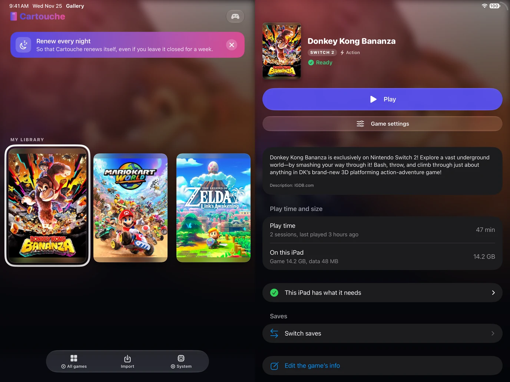
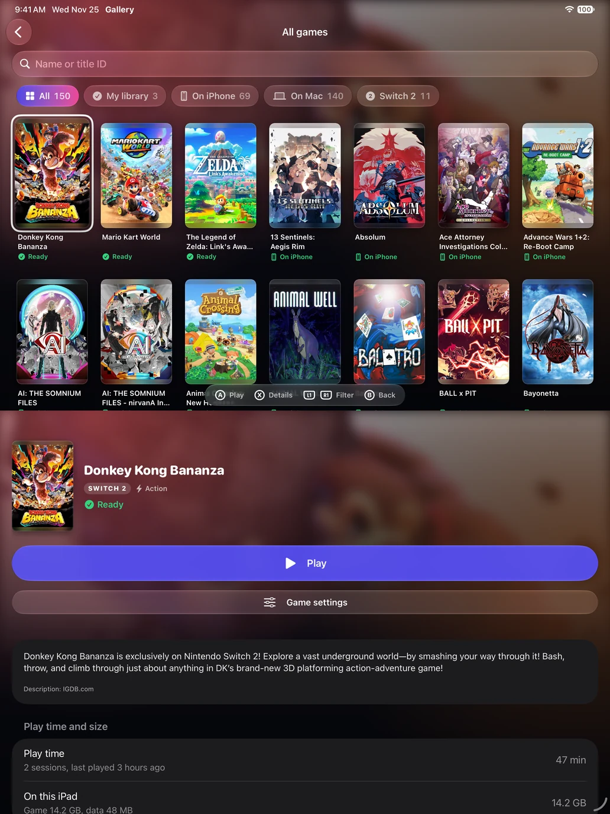

Cartouche est la même app sur iPhone et sur iPad, installée de la même façon, et dit « iPad » partout où il parle de votre appareil. Il tourne sur un iPad à puce M1 ou plus récente, sous iPadOS 26 ou plus récent.

- **À l'horizontale**, la console et la fiche du jeu se tiennent côte à côte.
- **Les jeux se jouent à l'horizontale :** tournez votre iPad pour jouer. Un jeu fait pour être joué couché reste couché.
- **Tout le reste** fonctionne comme sur l'iPhone : [stockage](/fr/iphone/storage/), [sauvegardes](/fr/iphone/saves/), votre [Mac](/fr/mac/iphone/), [Cartouche Cloud](/fr/cloud/) et la [page Système](/fr/iphone/system/).

Vos sauvegardes vous suivent de votre iPhone à votre iPad et retour, par votre dossier des sauvegardes : la plus récente gagne.
