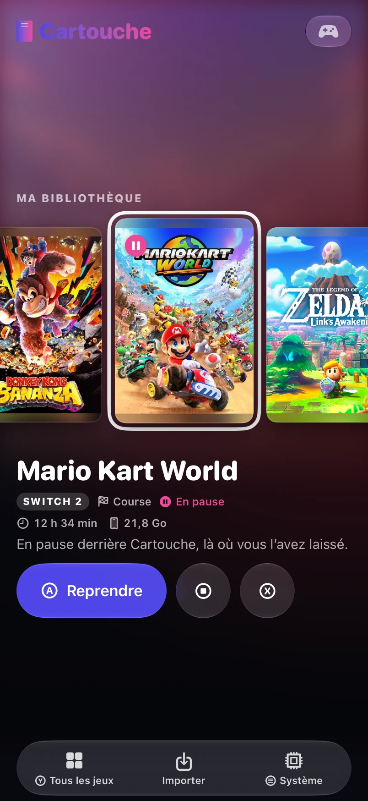
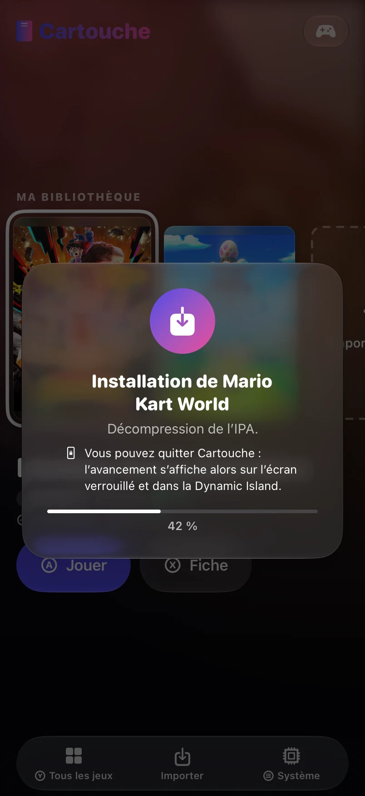

## Le jeu attend derrière la console

**Jouer** lance le jeu en plein écran, mode Jeu activé : le plus du processeur et de la puce graphique de l'iPhone, et vos manettes avec la latence la plus basse.

Le bouton **Home**, en bas de l'écran du jeu ou sur la manette, ramène la console sans arrêter le jeu. Le jeu reste en pause là où vous l'avez laissé :

- **Reprendre**, ou de nouveau le bouton Home de la manette, y retourne ;
- **Quitter** l'arrête, une fois que vous l'avez confirmé : la progression depuis la dernière sauvegarde du jeu est perdue ;
- **Jouer** sur un autre jeu demande d'abord, car un seul jeu tourne à la fois.

Le bouton Home à l'écran se cache après quelques secondes : touchez juste en dessous de là où il était pour le faire revenir.

## Un jeu qui demande plus de mémoire

Un jeu qui demande plus de mémoire qu'il n'en a derrière la console démarre à la place de Cartouche, avec toute la mémoire de Cartouche : la console se ferme pendant qu'il tourne, et se rouvre quand le jeu s'arrête. La fiche du jeu le dit, avec **Réessayer derrière Cartouche**.

Si iOS ferme un jeu près de sa limite de mémoire derrière la console, Cartouche le dit, et le jeu démarre ensuite à la place de Cartouche. **Système › Pendant une partie › Garder Cartouche ouvert derrière le jeu** désactive la console derrière le jeu pour tous les jeux.

## Sur une TV

Branchez l'iPhone à une TV par un câble, ou recopiez son écran par AirPlay vers une Apple TV ou une TV compatible AirPlay. La TV montre le jeu seul, comme une console sur sa station, et les commandes restent sur l'iPhone. Avec la TV, le jeu reste couché.

Il n'y a pas de version Apple TV : l'iPhone fait tourner le jeu et l'envoie à la TV.

## Debout ou couché

Tenez l'iPhone debout, et un jeu construit par un nxnative récent tourne avec lui, son image au-dessus de ses commandes. Un jeu construit avant reste couché. Sur un iPad, tournez-le à l'horizontale pour jouer.

## Siri et l'écran d'accueil

Dites *« Lance Stardew Valley dans Cartouche »* à Siri, ou utilisez **Lancer un jeu**, l'action de Cartouche dans Raccourcis : le jeu démarre comme avec **Jouer**. Un raccourci ajouté à l'écran d'accueil donne au jeu sa propre icône. La fiche de chaque jeu montre comment, sous **Siri et écran d'accueil**.

## Installer et mettre à jour un jeu

Un jeu de votre dossier de jeux s'installe depuis sa fiche ou depuis l'accueil, avec **Installer depuis** cet endroit. L'écran dit comment il arrive, par câble, par Tailscale ou par le Wi-Fi, et à quelle vitesse, avec un conseil quand cela pourrait aller plus vite.

- Vous pouvez quitter Cartouche pendant ce temps : l'écran verrouillé et la Dynamic Island montrent l'avancement, dans une Activité en direct.
- Une connexion coupée reprend là où elle s'était arrêtée quand le réseau revient.
- Une construction plus récente d'un jeu de votre dossier de jeux apparaît en **Mettre à jour** : la mise à jour garde vos sauvegardes.
- Un jeu construit sans les fichiers du jeu s'installe avec le `romfs.img` posé à côté de son IPA dans le dossier de jeux.

Quand quelque chose bloque une installation ou un lancement, Cartouche dit pourquoi et quoi faire, et **Copier le rapport** sous l'erreur donne à qui vous aide ce dont il a besoin. Voir [Dépannage](/fr/help/troubleshooting/).
