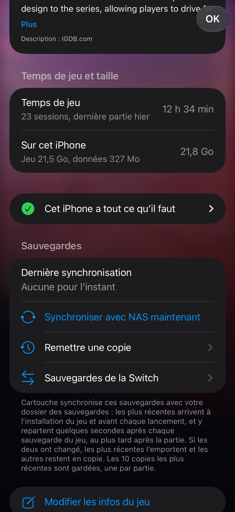
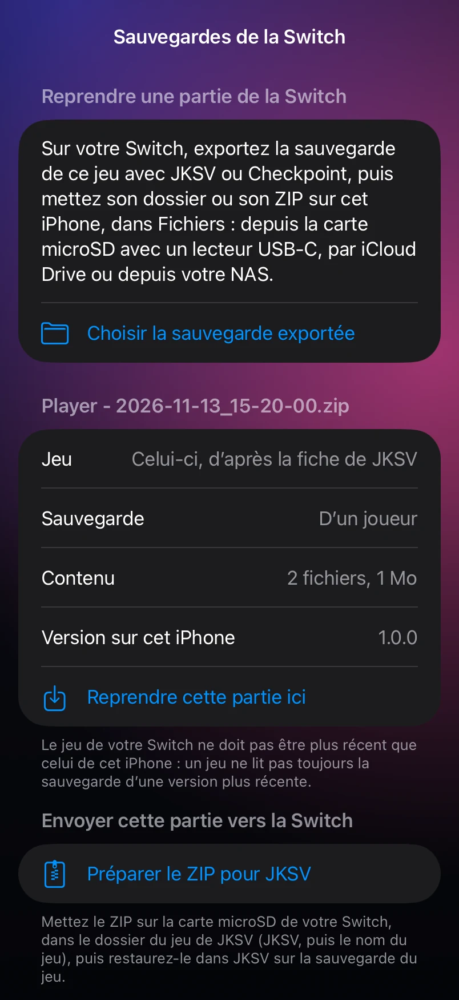

Avec un dossier des sauvegardes choisi dans **Système › Stockage**, Cartouche garde les sauvegardes de chaque jeu à jour avec lui, un dossier par jeu. Vos sauvegardes vous suivent d'un iPhone ou d'un iPad à l'autre, et jusqu'à votre Mac, par votre Mac ou votre NAS.

## Comment elles restent à jour

- **Elles partent** quelques secondes après chaque sauvegarde du jeu, pendant que vous jouez, et après la partie au plus tard.
- **Elles arrivent** quand vous installez le jeu et avant de jouer, comme après avoir réinstallé Cartouche, ou après qu'un autre iPhone ou votre Mac y a joué.
- **La plus récente gagne.** Quand les deux côtés ont changé, les sauvegardes écrites en dernier gagnent, et les autres restent dans le dossier, en copie à part.
- **Dix copies** de chaque jeu sont gardées, la plus récente d'abord.
- **Chaque copie nomme la version du jeu** qui l'a écrite : une version plus ancienne du jeu ne la prend jamais, et la fiche dit que la copie arrivera une fois le jeu mis à jour.

Un dossier des sauvegardes qui ne répond pas, un NAS pendant que vous êtes ailleurs, garde vos sauvegardes en attente : Cartouche les copie dès qu'il répond de nouveau.

## Sur la fiche d'un jeu

**Sauvegardes**, sur la fiche, dit quand elles ont été mises à jour pour la dernière fois et ce qu'a fait la dernière synchronisation.

- **Synchroniser avec** votre dossier **maintenant**, quand le jeu ne tourne pas.
- **Remettre une copie :** choisissez une des copies du jeu, la plus récente d'abord. Cartouche envoie d'abord les sauvegardes actuelles dans votre dossier, pour que vous puissiez y revenir.

## Revenir au début d'une partie

À chaque lancement, un jeu garde sur votre iPhone une copie des sauvegardes d'où il part, jusqu'à dix, avec ou sans dossier des sauvegardes. Si un mod ou une partie a mal tourné, ouvrez **Remettre une copie** sur la fiche du jeu : sous **Sur cet iPhone**, les copies marquées **Au début d'une partie** vous y ramènent.

Cartouche garde d'abord sur votre iPhone les sauvegardes qu'elles remplacent, sous **Avant la remise d'une copie**, et, avec un dossier des sauvegardes, les y envoie, puis la copie remise, comme la plus récente.

## Un jeu venu de votre console

Votre partie continue ici, là où vous l'avez laissée sur votre console :

1. Sur votre console, exportez la sauvegarde du jeu avec JKSV ou Checkpoint.
2. Mettez son dossier ou son ZIP sur cet iPhone, dans Fichiers.
3. Sur la fiche du jeu, ouvrez **Sauvegardes**, puis **Sauvegardes de la Switch**, et **Choisir la sauvegarde exportée**.
4. **Reprendre cette partie ici.** Cartouche vérifie que la sauvegarde est bien celle de ce jeu, garde celle qu'elle remplace et, avec un dossier des sauvegardes, l'y envoie comme la plus récente.

**Remettre la partie d'avant l'import** l'annule.

Dans l'autre sens, **Préparer le ZIP pour JKSV** met la sauvegarde du jeu dans un ZIP : posez-le sur la carte microSD de votre console, dans le dossier du jeu de JKSV, et restaurez-le dans JKSV.

:::caution
Le jeu sur votre console ne doit pas être plus récent que celui de votre iPhone : un jeu peut ne pas lire la sauvegarde d'une version plus récente.
:::

## Sur le Mac

Cartouche pour Mac garde les sauvegardes des jeux joués sur le Mac à jour avec le même dossier, selon les mêmes règles. Voir [La console sur le Mac](/fr/mac/console/#vos-sauvegardes-sur-le-mac).
