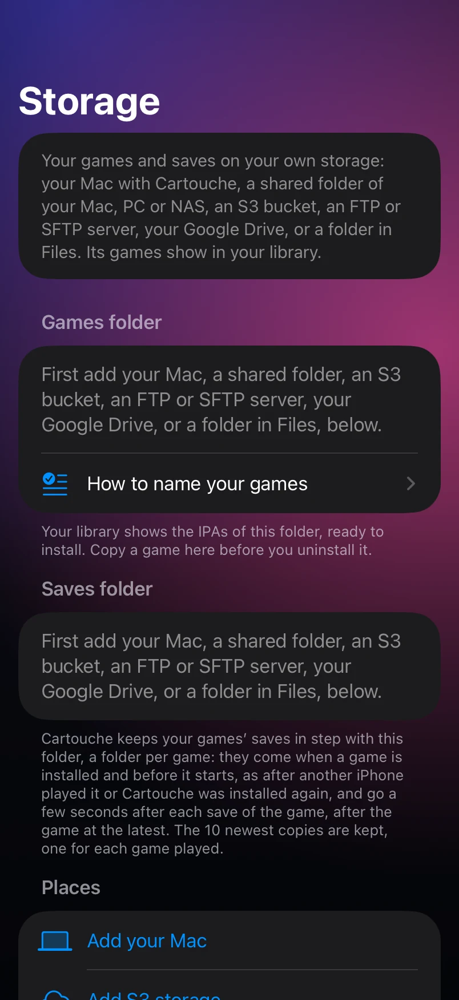
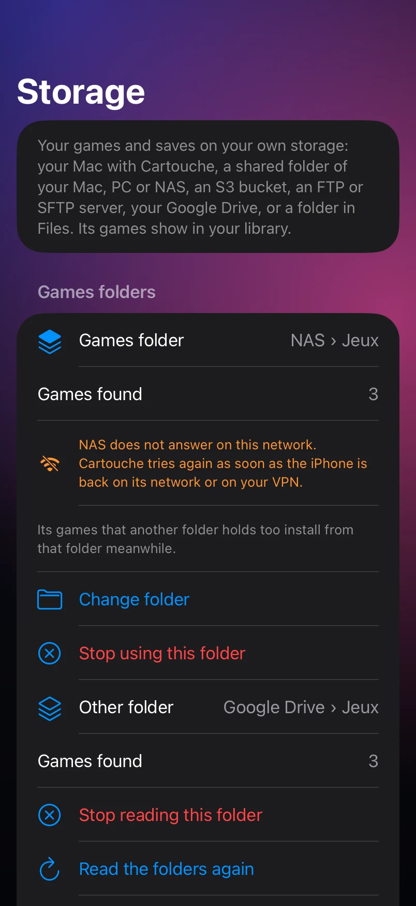
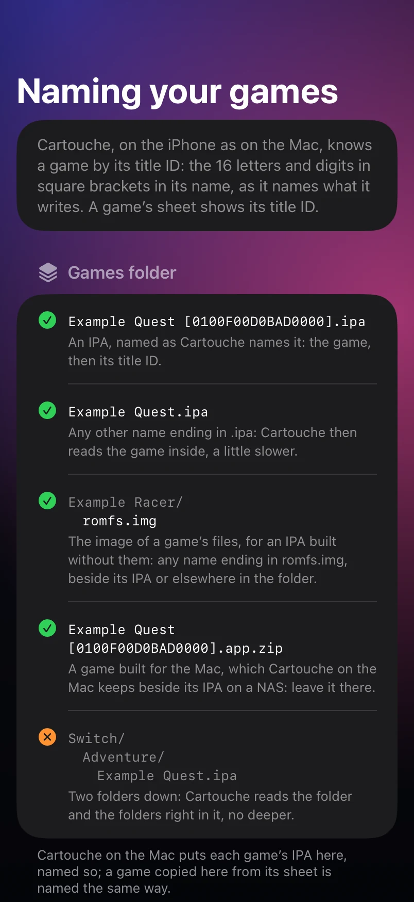
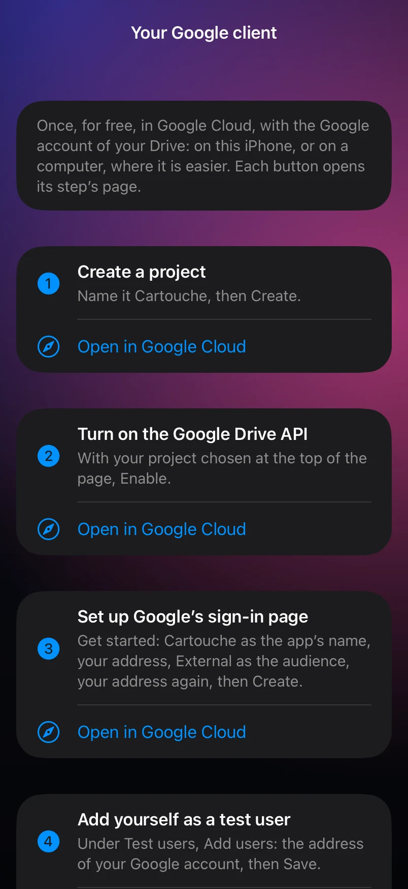

Vos jeux et vos sauvegardes restent chez vous, sur un stockage à vous, avec votre propre compte. **Système › Stockage** le met en place : les jeux qui s'y trouvent apparaissent dans votre bibliothèque, prêts à installer, et Cartouche y garde vos sauvegardes à jour, d'un iPhone ou d'un iPad à l'autre.

Il n'y a aucune adresse à coller pour un téléchargement, aucun lien à suivre et aucun bucket public : seulement vos propres endroits, avec votre propre compte. Les mots de passe restent dans le trousseau de l'iPhone.

## Les endroits

| Endroit | Comment Cartouche y accède |
| --- | --- |
| **Votre Mac** | Par [Cartouche pour Mac](/fr/mac/iphone/), sur votre Wi-Fi ou par câble : associé une fois avec six chiffres affichés sur les deux écrans, puis tout passe chiffré. |
| **Dossier partagé (SMB)** | SMB 2 ou 3, sur votre Mac, votre PC ou votre NAS, avec votre compte, ou en invité. Les serveurs de votre réseau apparaissent d'eux-mêmes. |
| **Bucket S3** | Un bucket privé à vous, sur Amazon S3 ou un serveur à vous comme MinIO, avec une clé d'accès de votre compte. Chaque requête est signée avec vos clés. |
| **Serveur FTP ou SFTP** | Celui de votre NAS ou de votre Mac, avec votre compte. En SFTP, Cartouche retient la clé du serveur et refuse toute autre. Le FTP envoie le mot de passe en clair : gardez-le pour votre propre réseau. |
| **Google Drive** | Votre Mon Drive, par un client Google à vous, créé une fois et gratuit ([plus bas](#google-drive)). Cartouche n'embarque aucune clé Google. |
| **Dossier de Fichiers** | N'importe quel dossier que l'app Fichiers atteint. |

La première fois, iOS demande de laisser Cartouche trouver des appareils sur votre réseau local : autorisez-le, sinon Cartouche ne voit ni votre Mac ni votre NAS.

## Le dossier de jeux

Choisissez le dossier qui contient les IPA de vos jeux. Votre bibliothèque montre alors chacun d'eux, prêt à installer, et une construction plus récente d'un jeu installé apparaît en mise à jour, sauvegardes gardées.

- **Ajouter un autre dossier de jeux**, sur n'importe lequel de vos endroits : un jeu trouvé dans plusieurs dossiers n'apparaît qu'une fois, et s'installe depuis un dossier qui répond, chez vous ou ailleurs.
- **Copier vers**, sur la fiche d'un jeu, copie le jeu installé dans votre dossier de jeux, le premier : faites-le avant de désinstaller un jeu dont vous n'avez pas l'IPA.
- Un dossier que votre compte peut seulement lire convient : Cartouche installe ses jeux et n'y écrit rien.
- Un jeu que nxnative a construit sans les fichiers du jeu vient en une IPA et un `romfs.img` : gardez les deux côte à côte, et Cartouche les installe ensemble.

## Le dossier des sauvegardes

Choisissez le dossier où Cartouche garde une copie de vos sauvegardes, un dossier par jeu. Voir [Vos sauvegardes](/fr/iphone/saves/).

## Comment nommer vos jeux

Cartouche reconnaît un jeu par son identifiant de titre, les 16 lettres et chiffres entre crochets dans son nom, comme `Celeste [01002B30028F6000].ipa`, et trouve la plupart des IPA même sans. **Comment nommer vos jeux**, sous le dossier de jeux, montre avec des exemples quels noms Cartouche trouve, lesquels il laisse de côté, et pourquoi.

## Hors de chez vous

Avec **Tailscale**, que vous installez à part depuis l'App Store sur l'iPhone et sur votre Mac ou votre NAS, connectés au même compte, Cartouche les atteint où que vous soyez : votre Mac tout seul, un NAS par son nom ou son adresse dans Tailscale. **Hors de chez vous**, sur la page Stockage, dit si Tailscale est connecté.

iOS ne garde qu'un VPN à la fois, donc LocalDevVPN coupe Tailscale quand Cartouche se renouvelle. Avec Tailscale allumé, Cartouche attend les 2 derniers jours de sa signature pour se renouveler, puis vous dit de rallumer Tailscale. Voir [Se renouveler chaque nuit](/fr/iphone/system/#se-renouveler-chaque-nuit).

## Quand un endroit ne répond pas

Un serveur qui ne répond pas depuis là où se trouve l'iPhone, un NAS chez vous pendant que vous êtes ailleurs, est *hors ligne*. Vos jeux installés se jouent comme toujours, votre dossier de jeux garde sa dernière liste, et vos sauvegardes attendent : Cartouche les copie dès que le serveur répond de nouveau. Il réessaie à chaque changement de réseau de l'iPhone, chaque minute tant que Cartouche est ouvert, et quand vous le demandez.

## Google Drive

Cartouche n'a pas de clé Google à lui : il atteint votre Drive par un client OAuth à vous, de type iOS, créé une fois gratuitement dans Google Cloud.

1. Sur la page Stockage, choisissez **Ajouter Google Drive**.
2. **Créer votre client, pas à pas** ouvre chaque page de Google Cloud tour à tour, avec l'identifiant de bundle de Cartouche à copier : créer un projet, activer l'API Google Drive, configurer la page de connexion de Google, vous ajouter comme utilisateur test, créer le client.
3. Collez l'identifiant du client, touchez **Se connecter avec Google**, et autorisez l'accès à votre Drive. Google dit ne pas avoir vérifié l'app : c'est la vôtre, choisissez **Continuer**.
4. Choisissez votre dossier de jeux dans Mon Drive.

Tant que votre projet Google Cloud est en test, Google met fin à la connexion après 7 jours : **Se reconnecter à Google** ramène le Drive, et vos sauvegardes attendent en attendant.

## Le même stockage sur votre Mac

Une fois votre iPhone associé à [Cartouche pour Mac](/fr/mac/iphone/), les deux gardent les mêmes connexions, mots de passe compris : une connexion ajoutée, changée ou retirée sur l'un arrive sur l'autre. Sur le Mac, **Système › Stockage** de la console les montre.

## Les sauvegardes de votre iPhone

Les jeux que Cartouche installe restent hors des sauvegardes de votre iPhone, dans iCloud ou sur un ordinateur, pour ne pas remplir votre iCloud : chacun pèse des gigaoctets, et se réinstalle depuis votre stockage. Leurs sauvegardes de jeu, elles, vont bien dans la sauvegarde.
