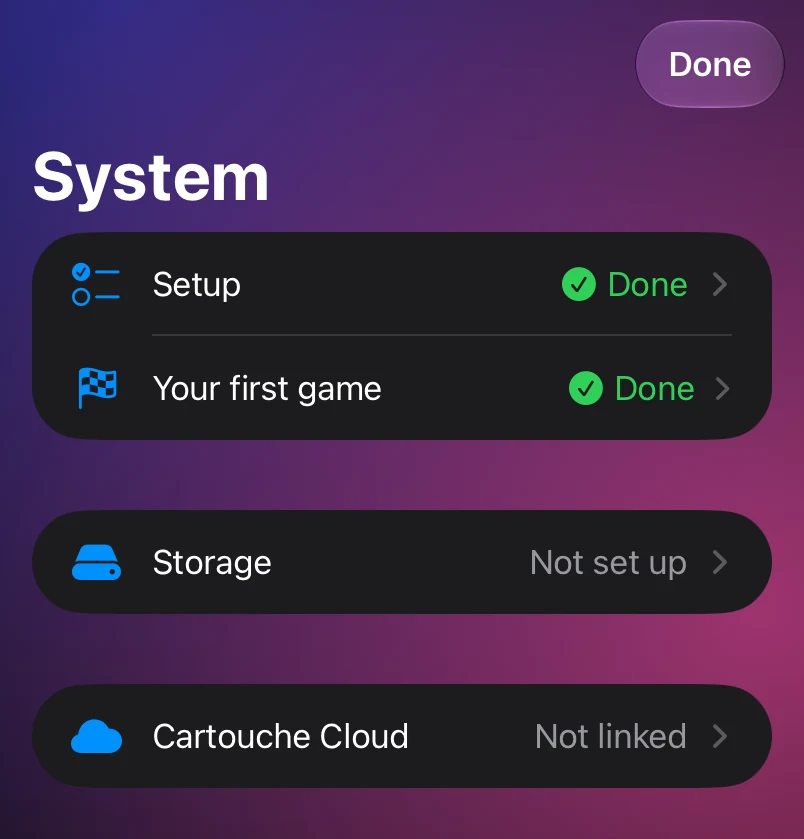
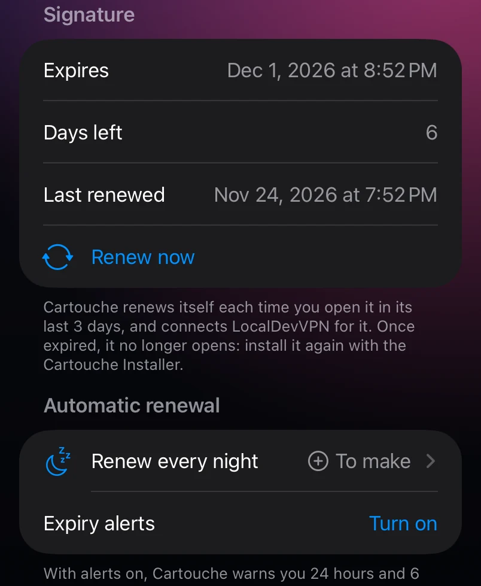
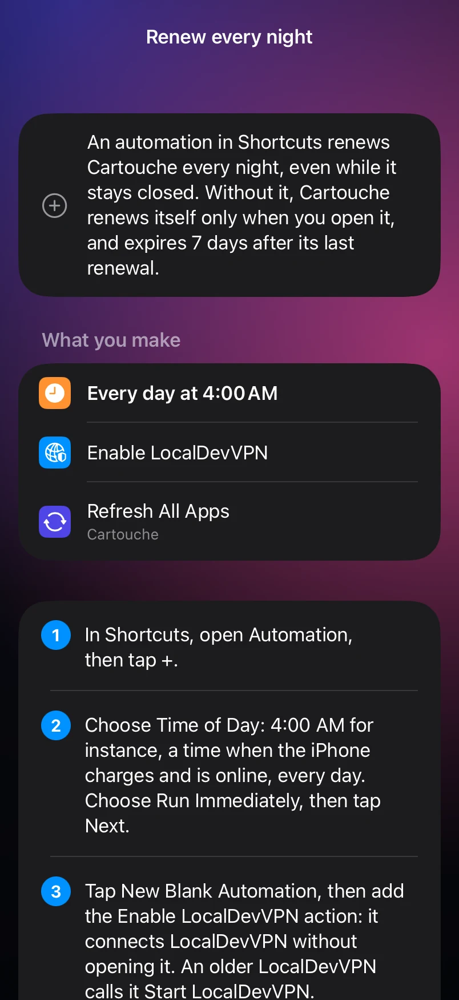
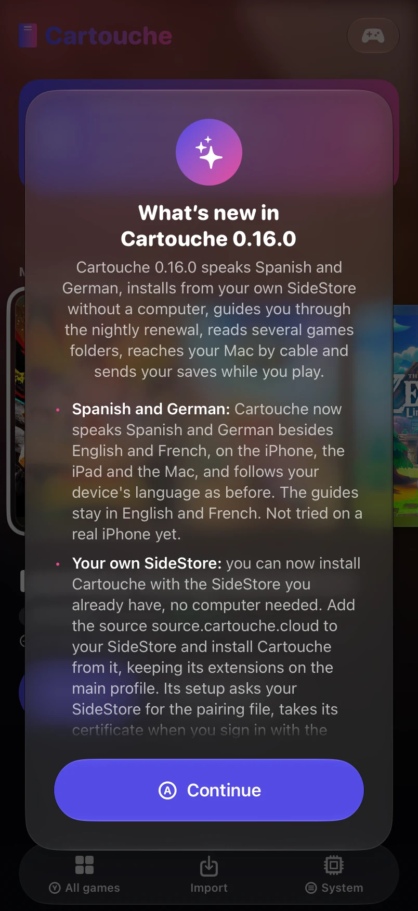
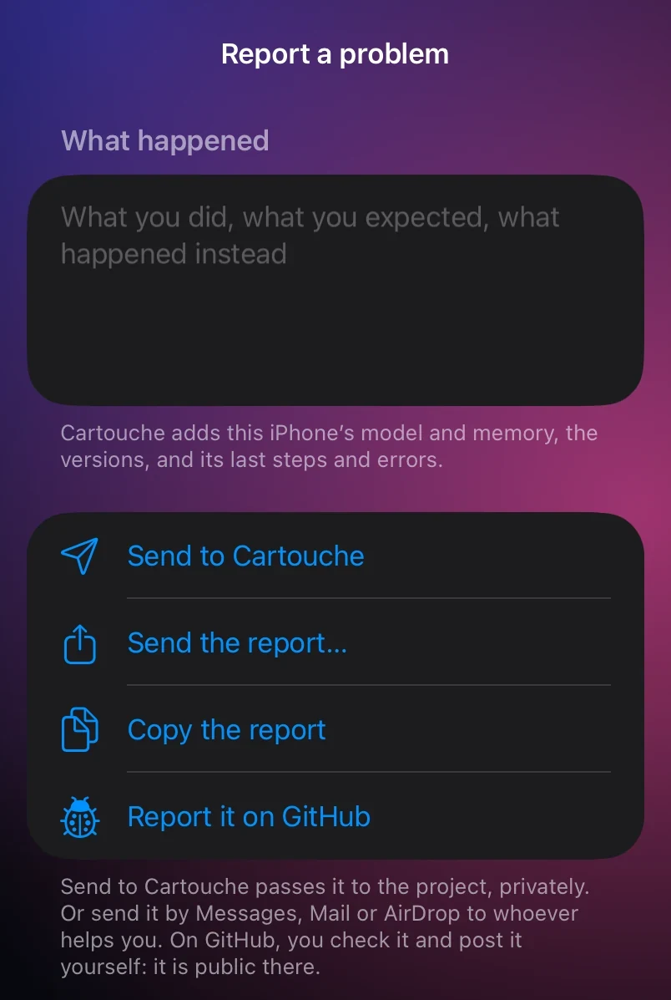

**Système**, dans le dock de la console ou par le bouton <kbd>Menu</kbd> de la manette, s'ouvre par-dessus la console. **OK**, ou de nouveau <kbd>Menu</kbd>, la ferme.

## Mise en route et signature

**Mise en route** montre les étapes de mise en route de Cartouche, cochées une fois faites. **Signature** dit quand la signature de Cartouche expire et les jours qui restent.

Un compte Apple gratuit signe les apps pour sept jours. Le SideStore intégré renouvelle Cartouche tout seul, par LocalDevVPN, que Cartouche connecte :

- à chaque ouverture de Cartouche dans les 3 derniers jours de sa signature ;
- quand vous touchez **Renouveler maintenant**, sans quitter Cartouche ;
- chaque nuit, avec l'automatisation Raccourcis [ci-dessous](#se-renouveler-chaque-nuit).

Avec **Alertes avant expiration** activé, Cartouche vous prévient 24 heures et 6 heures avant l'expiration. Une fois expiré, Cartouche ne s'ouvre plus : réinstallez-le avec l'[Installeur Cartouche](/fr/installer/), par-dessus cette copie, ce qui garde vos jeux et vos sauvegardes.

La session Apple a expiré ? Cartouche se reconnecte tout seul, ou vous le demande, avec **Se reconnecter**.

## Se renouveler chaque nuit

Une automatisation de Raccourcis renouvelle Cartouche chaque nuit, même s'il reste fermé. iOS ne laisse aucune app la créer à votre place, alors vous la créez une fois :

1. Dans Raccourcis, ouvrez **Automatisation**, puis touchez **+**.
2. Choisissez **Heure de la journée** : 4 h par exemple, une heure où l'iPhone charge et a internet, chaque jour. Choisissez **Exécuter immédiatement**, puis touchez **Suivant**.
3. Touchez **Nouvelle automatisation vide**, puis ajoutez l'action **Enable LocalDevVPN** : elle connecte LocalDevVPN sans l'ouvrir.
4. Ajoutez ensuite **Refresh All Apps**, parmi les actions de Cartouche et non de LiveContainer, puis touchez **OK**.
5. De retour dans Cartouche, touchez **J'ai créé l'automatisation**.

Cartouche suit chaque exécution : **Renouveler chaque nuit**, sur la page Système, dit si elle est à créer, créée, active ou en échec et pourquoi, et quoi corriger.

:::tip[Avec Tailscale]
LocalDevVPN éteint Tailscale, car iOS ne garde qu'un VPN à la fois. Ajoutez en dernier l'action **Connect** de Tailscale dans l'automatisation, et il se rallume tout seul.
:::

## Mises à jour

Cartouche propose ses nouvelles versions par-dessus la console, et les installe lui-même par LocalDevVPN, sans ordinateur. Il se ferme ensuite : rouvrez-le. Vos jeux, leurs sauvegardes et les réglages de Cartouche restent.

Après une mise à jour, Cartouche s'ouvre sur **Nouveautés**, dans votre langue. **Système › Mises à jour** a aussi **Chercher une mise à jour**, et les **Nouveautés** des dernières versions.

## Mémoire

Cartouche obtient la **Mémoire augmentée**, même avec un compte Apple gratuit. **Mémoire** montre la limite qu'iOS donne ici à Cartouche, celle qu'il a donnée au dernier jeu derrière la console, et si la Mémoire augmentée est active. **Pendant une partie** contient **Garder Cartouche ouvert derrière le jeu** ([Jouer](/fr/iphone/playing/#un-jeu-qui-demande-plus-de-mémoire)).

## Stockage, constructions et Cartouche Cloud

- **[Stockage](/fr/iphone/storage/) :** votre dossier de jeux, votre dossier des sauvegardes et vos endroits.
- **Constructions sur** votre Mac : avec un Mac associé, toutes ses constructions, pilotées depuis l'iPhone ([Votre iPhone et votre Mac](/fr/mac/iphone/)).
- **[Cartouche Cloud](/fr/cloud/iphone/) :** liez cet iPhone à votre compte, et suivez les jeux construits pour vous.

## Mesures de jeu

Après chaque partie, Cartouche envoie ce que nxnative a mesuré pendant que le jeu tournait, comme la fréquence d'images et la mémoire, pour que les jeux tournent mieux sur iPhone, iPad et Mac. Jamais votre compte Apple, le nom de votre iPhone, vos fichiers, les adresses de votre stockage ni le journal du jeu. **Système › Mesures de jeu** montre ce qui est envoyé, le désactive, et efface ce que cet iPhone a envoyé. Voir [Confidentialité](/fr/about/privacy/).

## Signaler un problème

**Signaler un problème** montre un rapport complet de ce qui s'est mal passé, avec le modèle de cet iPhone, les versions et les dernières étapes et erreurs de Cartouche, sans mots de passe, noms ni adresses de serveurs, noms d'utilisateur ni compte Apple. Rien ne quitte l'iPhone tant que vous n'avez pas choisi comment : **Envoyer à Cartouche**, en privé, ou par Messages, Mail ou AirDrop à qui vous aide. Voir [Obtenir de l'aide](/fr/help/support/).

## Autres apps installées

Une IPA que vous avez installée et qui n'est pas un jeu nxnative apparaît ici, et pas sur la console. Elle s'ouvre à la place de Cartouche, et peut être désinstallée d'ici.

## Réinitialiser Cartouche

**Réinitialiser Cartouche** efface tout ce que vous avez mis dans Cartouche, vos jeux et leurs sauvegardes ici, vos réglages et votre stockage, puis le relance comme à sa première ouverture, sans ordinateur. Les sauvegardes qui ne sont pas dans votre dossier des sauvegardes sont d'abord nommées, avec **Les envoyer maintenant dans le dossier des sauvegardes**. Ce que contient votre stockage, le certificat et le fichier de jumelage restent.

## Langue

Cartouche parle anglais, français, espagnol ou allemand : il suit la langue de votre iPhone.
