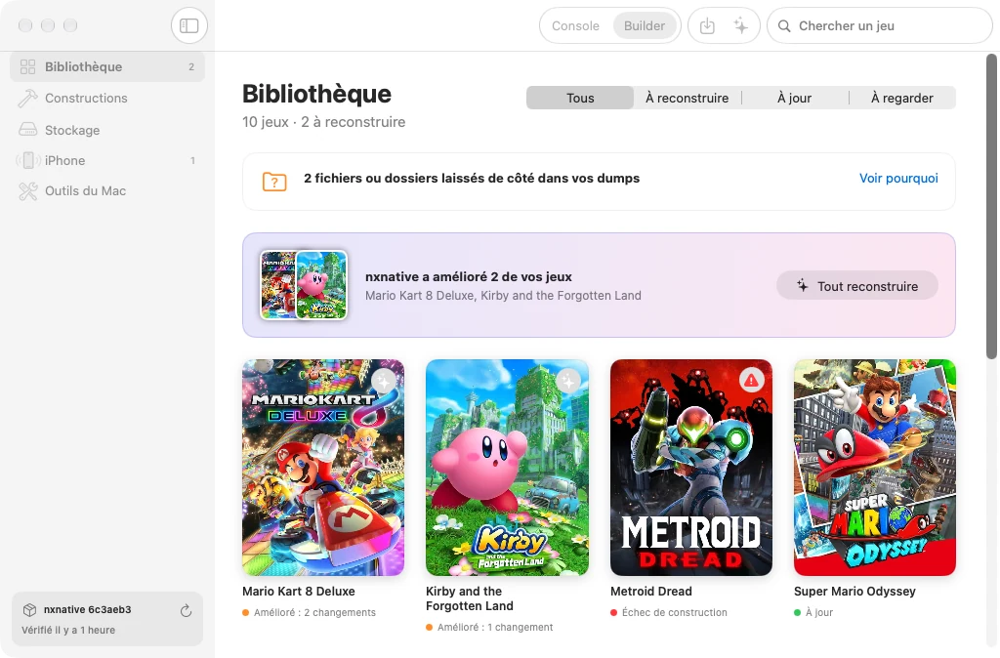
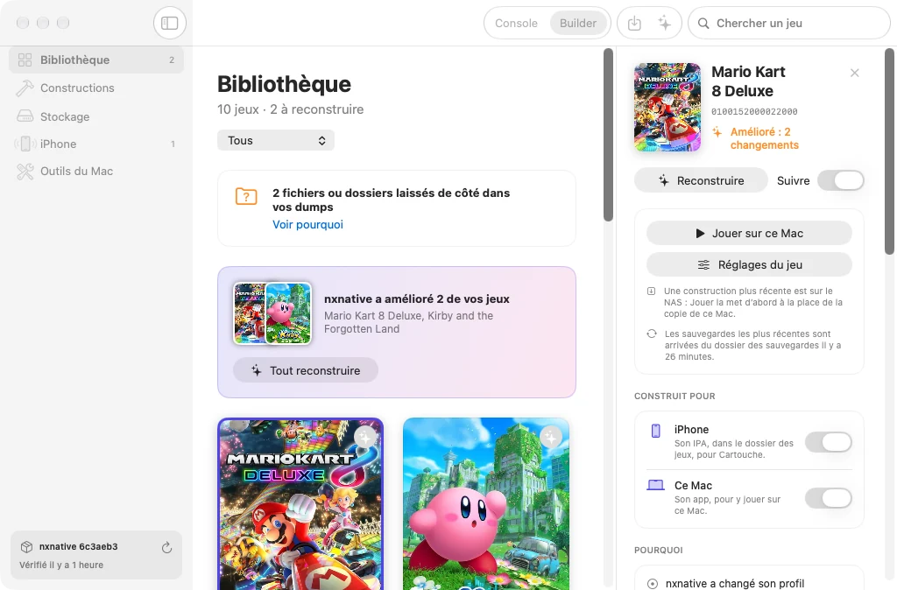
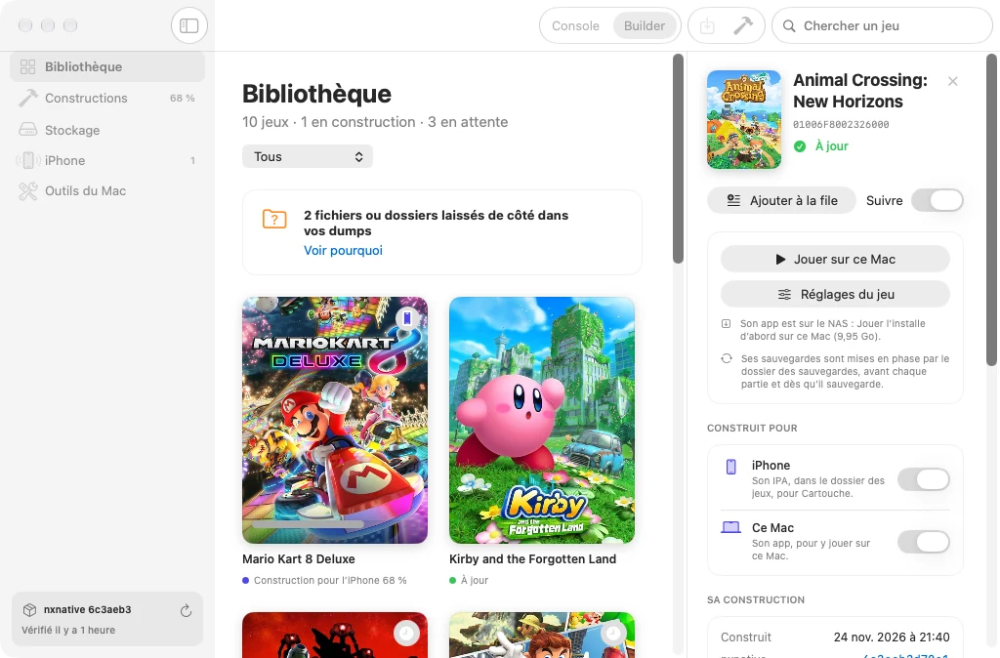

**Builder**, en haut de la fenêtre ou <kbd>⌘</kbd><kbd>2</kbd>, affiche le Builder. Il construit chacun de vos jeux avec nxnative en une IPA pour l'iPhone et l'iPad, et une app pour ce Mac, les dépose dans votre dossier des jeux, et les reconstruit quand nxnative les améliore.

## La bibliothèque

**Bibliothèque** montre vos jeux avec leurs jaquettes : ceux de votre dossier des dumps, et ceux dont seule l'IPA est dans votre dossier des jeux. Chacun dit s'il est à jour, à reconstruire et pourquoi, construit la nuit, ou en échec et ce qui a échoué. Filtrez-les par **Tous**, **À reconstruire**, **À jour** ou **À regarder**.

La fiche d'un jeu montre ce que nxnative a changé pour lui depuis sa construction, son IPA et son app pour ce Mac, **Construire**, **Reconstruire** ou **Construire à nouveau**, s'il est suivi, et pour quoi il est construit.

## Construire

Ouvrez un jeu et choisissez **Construire**. La première construction d'un gros jeu prend des heures ; les suivantes réutilisent son dossier de construction et prennent quelques minutes. **Constructions** montre le lot en cours, jeu par jeu et étape par étape, sa file, et les lots précédents avec leurs rapports.

- Un jeu demandé pendant qu'un lot construit, avec **Ajouter à la file**, attend son tour à la fin du lot.
- **Arrêter ce jeu** n'arrête que le jeu en construction ; **Tout arrêter** arrête le lot et vide sa file.
- Une notification dit quand un lot se termine.

## Mises à jour et DLC

Mettez la mise à jour et les DLC d'un jeu avec lui dans votre dossier des dumps : le Builder les construit avec le jeu, la mise à jour la plus récente et chaque DLC.

- **Les paquets** (`.nsp`, `.xci`, `.nsz`, `.xcz`) peuvent être à côté du jeu, dans un dossier à eux, comme `Zelda/Update/`, ou n'importe où ailleurs dans le dossier des dumps : le Builder reconnaît leur jeu à son identifiant de titre. Ils demandent `prod.keys`, choisi dans l'assistant de configuration ou dans les réglages.
- **Un dump** les range dans `updates/<version>/` et `dlc/` ; le `.nup` d'un jeu Switch 2 contient ceux qui y ont été mis.
- **Un `.nup` sans ses DLC** les prend en images : mettez l'image de chaque DLC, `1.img`, `2.img`… selon son numéro, dans un dossier nommé `aoc` à côté du `.nup`, dans le dossier du jeu. nxnative fait une telle image de chaque DLC avec lequel il construit un jeu, dans le dossier `aoc` du dossier de construction du jeu. Un `.nup` qui contient ses propres DLC garde ceux-là.
- **Une nouvelle mise à jour ou un nouveau DLC** dans le dossier des dumps fait reconstruire le jeu. Cartouche sur l'iPhone propose ensuite la mise à jour sur la fiche du jeu, sauvegardes gardées.

## Quand nxnative améliore vos jeux

nxnative reçoit des dizaines de changements par jour. Le Builder lit ce qui a changé depuis la construction de chaque jeu, et ne reconstruit un jeu que quand il y gagne quelque chose :

| Un jeu est reconstruit quand | |
| --- | --- |
| il n'a jamais été construit, ou son IPA a quitté le dossier des jeux | |
| son dossier contient de nouveaux fichiers | une nouvelle mise à jour, un DLC ou un dump |
| un changement de nxnative est fait pour lui | son profil, ou un correctif qui le nomme |
| le code commun de nxnative a changé | chaque semaine par défaut ; ou aussitôt, ou jamais, dans les réglages |
| Xcode a changé | |

**nxnative a amélioré** quelques-uns de vos jeux ? **Tout reconstruire** les construit. Cartouche sur l'iPhone propose ensuite chaque mise à jour sur la fiche du jeu, sauvegardes gardées.

Un jeu dont la construction a échoué attend que nxnative ou ses fichiers changent au lieu d'échouer de nouveau chaque nuit ; **Construire à nouveau** le construit aussitôt.

## Chaque nuit

**Construire ce qui est dû chaque nuit**, dans les réglages, construit ce que nxnative a amélioré à l'heure choisie, même app fermée. Le Mac reste éveillé pendant la construction, et une notification dit comment ça s'est passé. Un partage de votre NAS qui n'est pas monté est remonté tout seul.

## Construit pour l'iPhone et le Mac

Chaque jeu est construit pour l'iPhone et l'iPad, et aussi pour ce Mac, sauf si vous désactivez l'un des deux sous **Construire pour**, pour tous les jeux dans **Réglages › Constructions**, ou pour un jeu sur sa fiche. Voir [Jouer sur le Mac](/fr/mac/console/#jouer-sur-le-mac).

## Construire pour chacun de vos iPhone

L'iPhone 15, l'iPhone 15 Plus et les modèles plus anciens ont une puce graphique qui ne lit pas les textures compressées en BC, dont nxnative a besoin. **Réglages › Constructions › Construire pour** dit pour qui sont les jeux : vos iPhone associés, par défaut, ou un modèle que vous choisissez. Quand l'un d'eux ne lit pas les textures BC, le Builder construit chaque jeu avec [nxnative-nobc](https://github.com/mianmuhammadse/nxnative-nobc), une fourche distincte de nxnative par mianmuhammadse qui convertit ces textures ; sinon avec nxnative. Le réglage dit lequel et pourquoi.

## Peu de place sur le Mac

Chaque jeu garde un dossier de construction qui rend sa prochaine construction rapide. Le Builder évite de remplir votre disque : il retire les fichiers qu'il extrait une fois une construction finie, retire les dossiers de construction utilisés il y a le plus longtemps quand le disque se remplit, et dit avant une construction combien de place il manque. **Stockage** montre ce que garde le Builder, avec **Libérer**.

## Quand une construction n'aboutit pas

L'erreur sous un jeu, dans **Constructions**, dit quoi faire quand vous pouvez agir : un disque plein, des fichiers du jeu abîmés à recopier depuis votre console, ou un Xcode à mettre à jour. Quand le dernier changement de nxnative casse la construction d'un jeu, le Builder le construit tout seul à partir d'un changement antérieur qui marchait.

## Ce qu'il ne fait jamais

Il ne télécharge, ne partage ni n'envoie jamais un jeu, une clé ou une IPA ailleurs que sur votre propre stockage : il construit les jeux que vous possédez à partir de vos propres fichiers, sur votre Mac, dans votre propre dossier des jeux.
