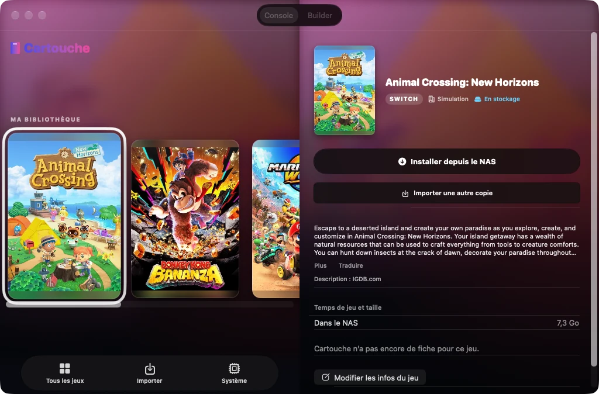
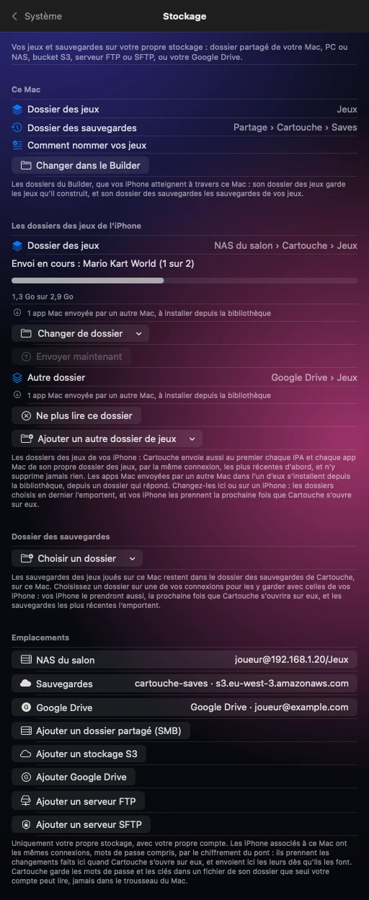

**Console**, en haut de la fenêtre ou <kbd>⌘</kbd><kbd>1</kbd>, affiche la console de Cartouche, comme sur l'iPhone : vos jeux construits pour ce Mac, avec leurs jaquettes, le jeu en focus avec **Jouer**, et sa fiche à côté.

## Jouer sur le Mac

**Jouer** lance le jeu aussitôt, en plein écran, la fenêtre de Cartouche derrière lui, avec vos sauvegardes les plus récentes. <kbd>⌃</kbd><kbd>⌘</kbd><kbd>F</kbd> le met dans une fenêtre. Quand le jeu s'arrête, Cartouche revient au premier plan.

- **Réglages du jeu** ouvre les réglages du jeu sur sa fiche, comme sur l'iPhone, avec ceux du Mac : mode d'affichage, **Plein écran** ou **Fenêtre**, et manettes.
- Le jeu parle la langue de votre Mac quand il l'a, jusqu'à ce que vous en choisissiez une.
- Un jeu que garde votre NAS et qui n'est pas encore sur ce Mac apparaît aussi : **Installer depuis le NAS** l'installe, puis **Jouer** le lance.
- **Retirer de ce Mac** met son app à la corbeille ; le jeu reste dans votre dossier des jeux.
- Quand la dernière manette se déconnecte en pleine partie, le jeu se met en pause 3 secondes plus tard et Cartouche revient au premier plan, en le disant. Une manette reconnectée relance le jeu, comme **Reprendre**, ou le jeu ramené au premier plan depuis le Dock. **Système › Pendant une partie** le désactive.

La fiche dit aussi combien de temps vous avez joué au jeu sur ce Mac et s'il y tourne.

## Vos sauvegardes sur le Mac

Le Mac garde les sauvegardes des jeux qui y sont joués à jour avec votre dossier des sauvegardes, comme l'iPhone : la copie la plus récente arrive avant qu'un jeu démarre, et les sauvegardes du Mac partent quelques secondes après que le jeu a sauvegardé. Quand les deux côtés ont changé, les sauvegardes écrites en dernier gagnent et les autres sont gardées en copie. La fiche les montre, avec **Synchroniser avec … maintenant** et **Remettre une copie**, et fait venir une sauvegarde de votre console comme sur l'iPhone.

La copie, sur ce Mac, d'un jeu que garde votre NAS reste hors de Time Machine : elle revient depuis le NAS. Les sauvegardes du jeu, elles, y vont.

## Système

**Système**, dans le dock de la console, ouvre la page Système de l'iPhone avec les sections propres à ce Mac :

- **Votre premier jeu :** le guide, en trois étapes pour ce Mac : l'assistant de configuration, un jeu construit pour ce Mac, et ce jeu joué.
- **Stockage :** vos connexions, les mêmes que celles de vos iPhone associés, et les dossiers des jeux et des sauvegardes du Mac ([plus bas](#le-même-stockage-que-votre-iphone)).
- **Ouvrir le Builder**, avec ses réglages.
- **Pendant une partie :** **Mettre en pause si la manette se déconnecte** ([plus haut](#jouer-sur-le-mac)).
- **Ce Mac :** son modèle, sa puce et macOS, et si sa puce graphique a ce dont nxnative a besoin.
- **Mises à jour :** celles de Cartouche pour Mac, avec **Rechercher une mise à jour** et **Installer les mises à jour toute seule**.
- **Mesures de jeu** et **Signaler un problème**, comme sur l'iPhone.

## Le même stockage que votre iPhone

Vos iPhone associés et le Mac gardent les mêmes connexions à votre stockage, mots de passe compris : un dossier partagé, un bucket S3, un serveur FTP ou SFTP ou votre Google Drive ajouté sur l'un arrive sur l'autre. Le dossier des jeux et le dossier des sauvegardes choisis sur l'un sont gardés par les deux.

Quand le dossier des jeux choisi sur l'iPhone est sur l'une de vos connexions, le Builder y envoie chaque jeu qu'il construit, un à la fois, pour que votre iPhone les trouve même quand le Mac dort.
