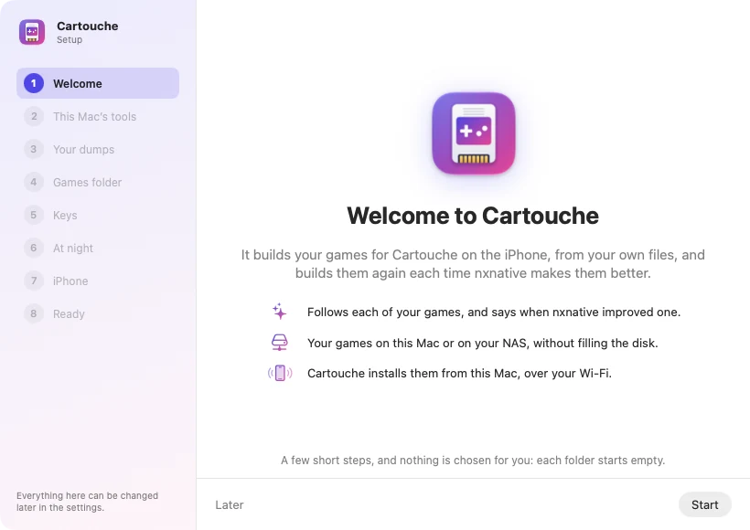
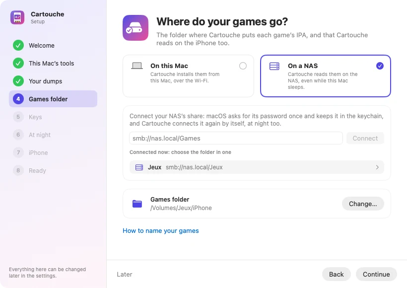
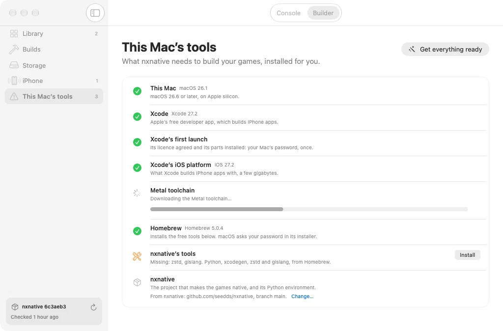

Sur le Mac, Cartouche est une seule app : sa **console**, comme sur l'iPhone, et le **Builder**, qui construit vos jeux avec nxnative à partir de vos propres copies, pour l'iPhone, l'iPad et le Mac. Il faut un Mac à puce Apple et macOS 26.6 ou plus récent.

## Télécharger et ouvrir la première fois

1. [Téléchargez Cartouche pour Mac](https://cartouche.cloud/download/#builder) : l'image disque se télécharge aussitôt.
2. Ouvrez-la, et glissez **Cartouche** sur **Applications**.
3. Ouvrez Cartouche depuis Applications. La première fois, macOS dit qu'il ne peut pas le vérifier, car il n'est pas signé par Apple : dans **Réglages Système › Confidentialité et sécurité**, cliquez sur **Ouvrir quand même** à côté de Cartouche, une fois. Ses mises à jour s'ouvrent ensuite sans redemander.

## L'assistant de configuration

À son premier lancement, un assistant de configuration prépare le Mac avec vous, une étape à la fois. Rien n'est choisi à votre place : chaque dossier part vide. Chaque choix est enregistré au fur et à mesure, et tous peuvent être changés plus tard dans les réglages, où **Avancé › Ouvrir l'assistant de configuration** le rouvre.

1. **Bienvenue :** ce que fait l'app.
2. **Outils du Mac :** **Tout préparer** installe ce avec quoi nxnative construit. Xcode vient de l'App Store, que l'app ouvre pour vous ; Homebrew demande le mot de passe de votre Mac ; le reste s'installe en arrière-plan pendant que vous passez aux étapes suivantes.
3. **Vos dumps :** le dossier de vos jeux, tels que vous les avez extraits de votre console, sur le Mac ou sur votre NAS. Le Builder ne fait que le lire.
4. **Dossier des jeux :** où vont les IPA de vos jeux, sur ce Mac ou sur votre NAS. C'est aussi le dossier que Cartouche lit sur l'iPhone.
5. **Clés :** les clés de votre console, `prod.keys`, pour les jeux en paquets.
6. **La nuit :** construire ou non ce qui est dû chaque nuit, et à quelle heure.
7. **iPhone :** si le Mac partage ses jeux et ses sauvegardes avec Cartouche sur l'iPhone, et comment l'associer.
8. **Prêt :** ce que chaque étape a choisi, avec un bouton pour y revenir.

:::tip[Vos jeux sur un NAS]
Pour un dossier sur votre NAS, tapez l'adresse de son partage dans l'assistant et le Finder le connecte, puis choisissez-y le dossier. macOS garde le mot de passe dans le trousseau, et Cartouche reconnecte le partage tout seul, la nuit aussi.
:::

## Les outils du Mac

**Outils du Mac**, dans le Builder, montre chaque outil dont nxnative a besoin, installé ou manquant, avec une installation pour ce qui manque, et **Mettre à jour Xcode** quand nxnative en demande un plus récent.

## Vos dumps

Le Builder lit vos jeux en paquets de votre console (`.nsp`, `.xci`, `.nsz`, `.xcz`, avec leurs mises à jour et DLC, qui demandent `prod.keys`, ou `.nup`), en dumps, ou en `.zip` d'un dump. Ils peuvent être en vrac dans le dossier, un dossier par jeu, ou dans des dossiers de dossiers. Un jeu est reconnu par son identifiant de titre ; la bibliothèque dit ce qu'elle a laissé de côté, et pourquoi.

**Nommer vos jeux**, sous **Dossiers** dans les réglages, montre avec des exemples ce que le Builder et Cartouche font de chaque nom.

## Les mises à jour

Cartouche pour Mac cherche ses nouvelles versions à son ouverture et toutes les six heures. Une nouvelle version est téléchargée, vérifiée, et mise en place quand l'app quitte, ou aussitôt avec **Redémarrer**. **Installer les mises à jour toute seule**, dans les réglages, peut être désactivé : l'app propose alors chaque mise à jour.

## Ensuite

[Construire vos jeux](/fr/mac/builder/).
