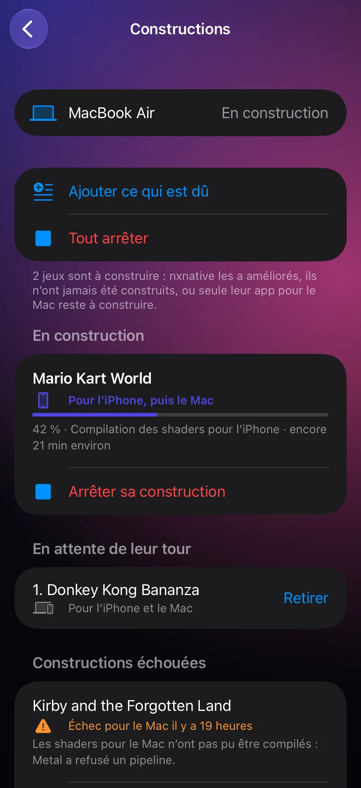

Associé une fois, votre Mac devient un endroit de stockage de Cartouche sur l'iPhone : Cartouche y installe vos jeux et y garde vos sauvegardes, chiffrées en chemin. Et l'iPhone pilote les constructions du Mac.

## Les associer

1. Sur le Mac, dans la page **iPhone** du Builder, activez **Partager avec Cartouche sur l'iPhone**.
2. Sur l'iPhone, dans **Système › Stockage**, choisissez **Ajouter votre Mac**, puis votre Mac sous **Macs à proximité**. La première fois, autorisez Cartouche à trouver des appareils sur votre réseau local.
3. Les deux écrans affichent six chiffres : quand ce sont les mêmes, cliquez sur **Autoriser** sur le Mac.

Le Mac partage deux dossiers, et rien d'autre de lui n'est accessible : **Jeux**, votre dossier des jeux, où qu'il soit, sur le Mac ou sur votre NAS ; et **Sauvegardes**, le dossier que vous choisissez pour les copies de vos sauvegardes. La clé que partagent les deux ne passe jamais sur le réseau, et chaque message est chiffré.

## En Wi-Fi, par câble, ou hors de chez vous

- **Par câble :** branchez l'iPhone au Mac, et il atteint le Mac par le câble, sans Wi-Fi. **Ajouter votre Mac** montre ce Mac en premier, **Par câble**. L'iPhone doit faire confiance au Mac, comme le Finder le demande une fois.
- **Sur votre Wi-Fi :** l'iPhone trouve le Mac tout seul, ou à l'adresse où il l'a joint la dernière fois, par votre VPN aussi. Le Mac reste éveillé tant qu'un iPhone est connecté.
- **Hors de chez vous :** avec Tailscale sur le Mac et sur l'iPhone, connectés au même compte, l'iPhone atteint le Mac par Tailscale. Un Mac jamais croisé sur votre Wi-Fi s'associe par son nom ou son adresse Tailscale, sous **Ajouter votre Mac › Par son adresse**.

Le Mac répond tant que Cartouche y est ouvert.

## Piloter les constructions du Mac depuis l'iPhone

- La fiche de chaque jeu montre **Constructions sur** votre Mac : en construction, avec l'avancement et le temps restant, en attente de son tour, à jour, amélioré par nxnative, ou en échec et pourquoi. Son bouton demande au Mac de le construire, maintenant ou après le lot en cours, ou arrête sa construction.
- **Système › Constructions sur** votre Mac montre toutes ses constructions, comme sa propre fenêtre : **Construire ce qui est dû**, **Tout arrêter**, la file avec **Retirer**, les constructions échouées, **Suivre** pour chaque jeu, et **Construire ce qui est dû chaque nuit** avec son heure.

Les dossiers du Mac, ses outils et ses réglages restent sur le Mac.

## Les mêmes connexions

Une fois associés, l'iPhone et le Mac gardent les mêmes connexions à votre stockage, mots de passe compris : une connexion ajoutée, changée ou retirée sur l'un arrive sur l'autre. Voir [Le même stockage que votre iPhone](/fr/mac/console/#le-même-stockage-que-votre-iphone).

## Garder les deux à jour

Cartouche sur l'iPhone et Cartouche pour Mac se parlent : quand l'un est bien plus ancien, l'iPhone dit de mettre à jour les deux. Cartouche pour Mac se met à jour tout seul ; un ancien Cartouche pour Mac qui ne trouve plus ses mises à jour en reçoit le lien depuis l'iPhone, dans **Système › Constructions sur** votre Mac.
