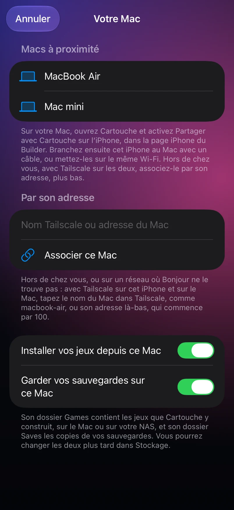
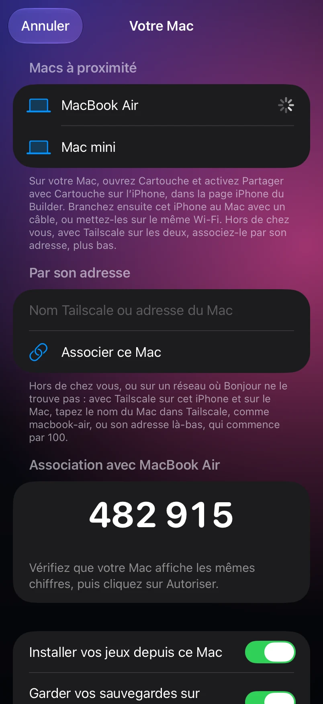
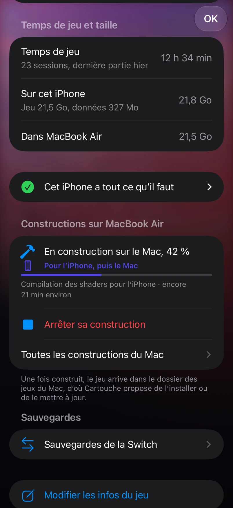

Associé une fois, votre Mac devient un endroit de stockage de Cartouche sur l'iPhone : Cartouche y installe vos jeux et y garde vos sauvegardes, chiffrées en chemin. Et l'iPhone pilote les constructions du Mac.

## Les associer

1. Sur le Mac, dans la page **iPhone** du Builder, activez **Partager avec Cartouche sur l'iPhone**.
2. Sur l'iPhone, dans **Système › Stockage**, choisissez **Ajouter votre Mac**, puis votre Mac sous **Macs à proximité**. La première fois, autorisez Cartouche à trouver des appareils sur votre réseau local.
3. Les deux écrans affichent six chiffres : quand ce sont les mêmes, cliquez sur **Autoriser** sur le Mac.

Le Mac partage deux dossiers, et rien d'autre de lui n'est accessible : **Jeux**, votre dossier des jeux, où qu'il soit, sur le Mac ou sur votre NAS ; et **Sauvegardes**, le dossier que vous choisissez pour les copies de vos sauvegardes. La clé que partagent les deux ne passe jamais sur le réseau, et chaque message est chiffré.

## En Wi-Fi, par câble, ou hors de chez vous

- **Par câble :** branchez l'iPhone au Mac, et il atteint le Mac par le câble, sans Wi-Fi. **Ajouter votre Mac** montre ce Mac en premier, **Par câble**. L'iPhone doit faire confiance au Mac, comme le Finder le demande une fois.
- **Un jeu de votre NAS, via le Mac :** tant que l'iPhone est branché à un Mac qui atteint votre NAS, votre serveur FTP ou SFTP en Ethernet, un jeu de vos dossiers des jeux qui s'y trouvent passe par le Mac et le câble, sans rien à régler. L'écran de l'installation dit alors **Par câble, via le Mac**. En Wi-Fi, le Mac laisse l'iPhone lire le NAS lui-même.
- **Sur votre Wi-Fi :** l'iPhone trouve le Mac tout seul, ou à l'adresse où il l'a joint la dernière fois, par votre VPN aussi. Le Mac reste éveillé tant qu'un iPhone est connecté.
- **Hors de chez vous :** avec Tailscale sur le Mac et sur l'iPhone, connectés au même compte, l'iPhone atteint le Mac par Tailscale. Un Mac jamais croisé sur votre Wi-Fi s'associe par son nom ou son adresse Tailscale, sous **Ajouter votre Mac › Par son adresse**.

Le Mac répond tant que Cartouche y est ouvert.

## Cartouche renouvelé par votre Mac

Cartouche s'ouvre sept jours d'affilée sur votre iPhone, puis doit être renouvelé. Cartouche pour Mac le renouvelle pour vous, par le câble ou sur votre Wi-Fi, avec ou sans le partage ci-dessus, et sans LocalDevVPN :

1. Dans la page **iPhone** du Builder, sous **Renouvellement de Cartouche**, cliquez sur **Se connecter…**, connectez-vous avec le compte Apple qui a installé Cartouche, puis saisissez le code qu'Apple envoie.
2. Branchez l'iPhone au Mac, et faites confiance au Mac s'il le demande. Pour l'atteindre aussi sur votre Wi-Fi, activez sa synchronisation Wi-Fi dans le Finder.

Dès lors, le Mac regarde toutes les demi-heures les iPhone qu'il atteint tant qu'il est ouvert, sa fenêtre ou sa barre des menus, et renouvelle Cartouche dans ses deux derniers jours, ou une fois expiré. **Renouveler** le fait tout de suite. Un renouvellement ne réinstalle rien : Cartouche garde ses jeux, ses sauvegardes et sa mémoire augmentée, et montre sa nouvelle date à son lancement suivant.

Votre mot de passe va à Apple seul, une fois : le Mac ne garde que la session qu'Apple donne en retour, et ne vous demande donc jamais votre mot de passe quand il s'ouvre, construit ou joue. Une fois qu'Apple a fermé cette session (une connexion ailleurs, un nouveau mot de passe, ou les jours qu'Apple lui donne) et qu'un renouvellement est dû, une notification, une par jour au plus, dit de se reconnecter dans la page **iPhone**. Le Mac ne touche pas à un Cartouche installé avec un autre compte Apple.

### Quand son certificat a disparu

Un Cartouche dont le certificat n'est plus sur votre compte, révoqué par un autre ordinateur ou une autre app avec le même compte Apple, ne se rouvre qu'avec une installation par-dessus. Le Mac la fait comme l'Installeur Cartouche met Cartouche à jour : la dernière version, depuis les versions de Cartouche sur GitHub, signée avec votre compte Apple et un certificat de ce Mac, *Cartouche for Mac*. Cartouche garde ses jeux, ses sauvegardes et sa mémoire augmentée. Le Mac la fait de lui-même une fois Cartouche expiré, pour qu'aucun jeu ne soit en cours ; avant, une notification le dit une fois, et **Réinstaller**, dans la page **iPhone**, la fait tout de suite. Cela prend une minute ou deux, et la page montre où elle en est.

Le Mac ne révoque jamais de certificat. Si votre compte en a déjà autant qu'Apple le permet, il n'installe rien et le dit : révoquez-en un qui ne sert plus dans la page **Certificats** de l'Installeur Cartouche, et le Mac réessaie.

## Piloter les constructions du Mac depuis l'iPhone

- La fiche de chaque jeu montre **Constructions sur** votre Mac : en construction, avec l'avancement et le temps restant, en attente de son tour, à jour, amélioré par nxnative, ou en échec et pourquoi. Son bouton demande au Mac de le construire, maintenant ou après le lot en cours, ou arrête sa construction.
- **Système › Constructions sur** votre Mac montre toutes ses constructions, comme sa propre fenêtre : **Construire ce qui est dû**, **Tout arrêter**, la file avec **Retirer**, les constructions échouées, **Suivre** pour chaque jeu, et **Construire ce qui est dû chaque nuit** avec son heure.

Les dossiers du Mac, ses outils et ses réglages restent sur le Mac.

## Les mêmes connexions

Une fois associés, l'iPhone et le Mac gardent les mêmes connexions à votre stockage, mots de passe compris : une connexion ajoutée, changée ou retirée sur l'un arrive sur l'autre. Voir [Le même stockage que votre iPhone](/fr/mac/console/#le-même-stockage-que-votre-iphone).

## Garder les deux à jour

Cartouche sur l'iPhone et Cartouche pour Mac se parlent : quand l'un est bien plus ancien, l'iPhone dit de mettre à jour les deux. Cartouche pour Mac se met à jour tout seul ; un ancien Cartouche pour Mac qui ne trouve plus ses mises à jour en reçoit le lien depuis l'iPhone, dans **Système › Constructions sur** votre Mac.
