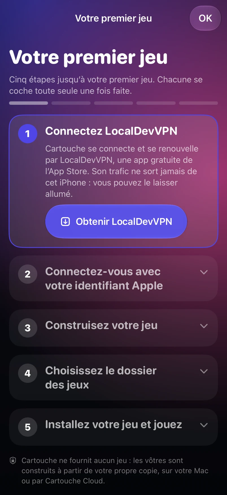
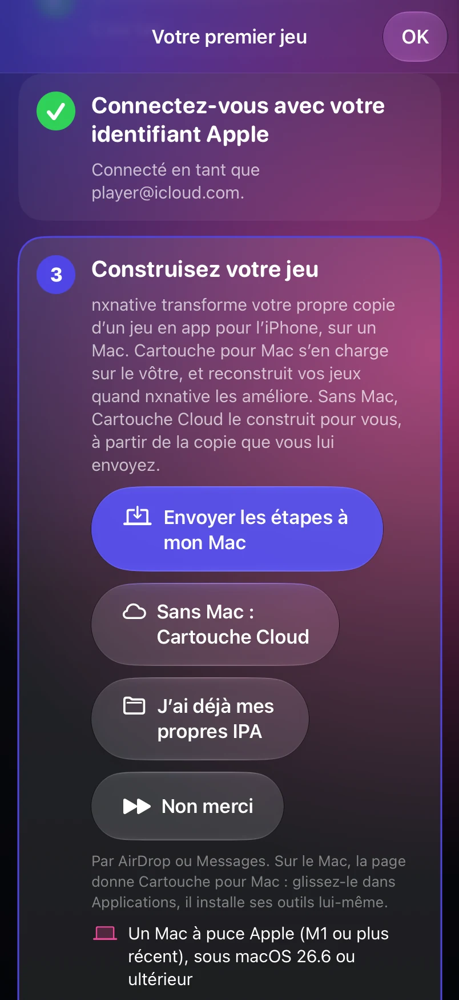
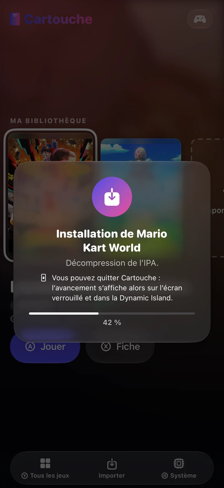

La première fois que vous ouvrez Cartouche, son guide, **Votre premier jeu**, s'ouvre sur l'étape à faire. Chaque étape se coche toute seule une fois faite, dans n'importe quel ordre, et le guide vous mène jusqu'à jouer.

## 1. Connecter LocalDevVPN et se connecter

Les étapes de la mise en route, vues dans [Installer Cartouche](/fr/start/install/#4-la-mise-en-route-de-cartouche). Le guide les montre d'abord tant qu'elles ne sont pas faites.

## 2. Construire votre jeu

Votre jeu, c'est votre propre copie, tirée de votre console. nxnative en fait une app pour l'iPhone, sur un Mac. Choisissez le chemin qui vous va :

- **Avec votre Mac :** **Envoyer les étapes à mon Mac** envoie au Mac, par AirDrop ou Messages, la page de [Cartouche pour Mac](/fr/mac/install/). Installez-le là-bas ; il construit votre jeu et le dépose dans votre dossier de jeux.
- **Sans Mac : Cartouche Cloud** ouvre [Cartouche Cloud](/fr/cloud/) : envoyez votre copie depuis un ordinateur, et le jeu construit pour vous arrive dans Cartouche.
- **J'ai déjà mes propres IPA** ouvre Fichiers : l'IPA choisie s'installe.
- **Non merci :** vos jeux sont déjà construits, sur votre NAS par exemple. Le guide passe à votre dossier de jeux.

## 3. Choisir votre dossier de jeux

**Choisir le dossier des jeux** ouvre la page [Stockage](/fr/iphone/storage/) : ajoutez votre Mac, un dossier partagé de votre NAS, un bucket S3, un serveur FTP ou SFTP, votre Google Drive ou un dossier de Fichiers, puis choisissez le dossier qui contient vos jeux. Cartouche liste vos jeux à partir de là et propose leurs mises à jour.

Avec Cartouche Cloud, pas besoin de dossier de jeux : le guide saute cette étape. Aucun dossier de jeux ? **Importer plutôt une IPA** installe une IPA depuis Fichiers.

## 4. Installer votre jeu et jouer

Votre jeu apparaît dans la dernière étape du guide et dans votre bibliothèque. **Installer** l'installe, depuis votre dossier de jeux ou depuis Cartouche Cloud, puis sa fiche s'ouvre avec **Jouer**.

Vos jeux suivants prennent le même chemin : construits sur le Mac ou par Cartouche Cloud, puis installés.

## Rouvrir le guide

- Le **×** de la carte du guide la retire de l'accueil.
- **Système › Votre premier jeu** le rouvre quand vous voulez.
- Tant que vous n'avez pas de jeu, **Comment avoir un jeu**, à côté de **Importer ma copie**, l'ouvre aussi.

Sur le Mac, la console de Cartouche a son propre guide, en trois étapes : l'assistant de configuration, un jeu construit pour ce Mac, et ce jeu lancé. Voir [La console sur le Mac](/fr/mac/console/).
