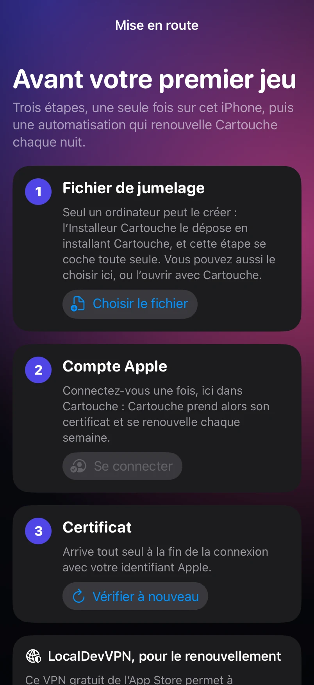

Un ordinateur sert une fois, pour mettre Cartouche sur votre iPhone ou votre iPad. Ensuite, Cartouche se signe, se renouvelle et se met à jour sans lui. Vous utilisez déjà SideStore ? [Installez-le plutôt depuis SideStore](/fr/start/sidestore/), sans ordinateur.

Sur un iPad, chaque étape est la même, avec l'iPad à la place de l'iPhone.

## 1. LocalDevVPN sur l'iPhone

Installez **LocalDevVPN**, gratuit, depuis l'App Store. Cartouche se connecte et se renouvelle par lui. Son trafic ne quitte jamais l'iPhone, et Cartouche le connecte tout seul quand il en a besoin.

## 2. L'Installeur de Cartouche sur votre ordinateur

1. Téléchargez l'Installeur de Cartouche [pour Mac](https://cartouche.cloud/download/#installer-mac) ou [pour Windows](https://cartouche.cloud/download/#installer-windows). Sous Windows, installez aussi **Apple Devices** depuis le Microsoft Store, pour que Windows puisse parler à l'iPhone.
2. Ouvrez-le. Il n'est pas certifié par Apple ou Microsoft, donc la première fois :
   - sur un Mac, ouvrez **Réglages Système › Confidentialité et sécurité** et cliquez sur **Ouvrir quand même** à côté de Cartouche Installer, une fois ;
   - sous Windows, si SmartScreen arrête l'installation, choisissez **Informations complémentaires › Exécuter quand même**.
3. Branchez l'iPhone à l'ordinateur avec un câble et déverrouillez-le. La première fois, touchez **Se fier** sur l'iPhone et tapez son code.
4. Dans l'Installeur, connectez-vous avec votre compte Apple (un compte gratuit suffit), et tapez le code qu'Apple envoie à vos appareils.
5. Cliquez sur **Installer Cartouche**. L'Installeur télécharge le Cartouche le plus récent, le vérifie, le signe avec la mémoire augmentée et l'installe, avec son certificat et le fichier de jumelage dont il a besoin.

Plus sur l'Installeur, ses réglages et quoi faire quand il s'arrête : [Installeur de Cartouche](/fr/installer/).

:::tip[Votre propre certificat]
Vous avez un certificat de signature (.p12) et son profil d'approvisionnement ? L'Installeur peut signer Cartouche avec eux à la place, sans compte Apple et sans renouvellement chaque semaine. Voir [Votre propre certificat](/fr/installer/own-certificate/).
:::

## 3. La première fois sur l'iPhone

Avant d'ouvrir Cartouche la première fois :

1. Dans **Réglages › Général › VPN et gestion de l'appareil**, faites confiance à votre compte Apple.
2. Si iOS le demande, activez le **Mode développeur** dans **Réglages › Confidentialité et sécurité**, et redémarrez l'iPhone.

## 4. La mise en route de Cartouche

Ouvrez Cartouche. Sa mise en route tient en quelques étapes, une fois :

1. **LocalDevVPN, pour le renouvellement :** **Connecter LocalDevVPN** le connecte et vous ramène dans Cartouche.
2. **Compte Apple :** connectez-vous avec le compte Apple donné à l'Installeur, et tapez le code qu'Apple envoie. Cartouche prend son certificat.
3. **Fichier de jumelage :** déjà posé par l'Installeur ; cette étape se coche toute seule.
4. **Renouveler chaque nuit :** la dernière étape montre l'automatisation Raccourcis à créer une fois, pour que Cartouche se renouvelle chaque nuit même s'il reste fermé. Voir [Se renouveler chaque nuit](/fr/iphone/system/#se-renouveler-chaque-nuit).

Une fois la mise en route faite, Cartouche renouvelle tout seul sa signature de sept jours et propose ses propres mises à jour. Vos jeux et leurs sauvegardes restent à chaque mise à jour.

## Ensuite

[Votre premier jeu](/fr/start/first-game/) : le guide de Cartouche vous mène d'ici jusqu'à jouer.
