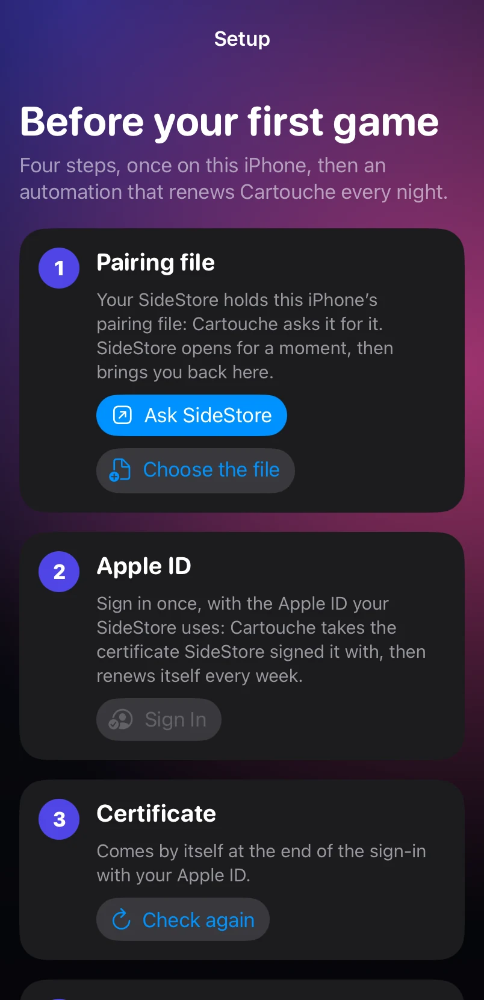

Si SideStore est déjà sur votre iPhone ou votre iPad, vous pouvez y installer Cartouche, sans ordinateur.

1. Dans SideStore, ajoutez la source de Cartouche : `https://source.cartouche.cloud`. Sur l'iPhone, le bouton ci-dessous l'ajoute pour vous.

   <a href="sidestore://source?url=https://source.cartouche.cloud">Ajouter à SideStore</a>

2. Installez **Cartouche** depuis cette source. Quand SideStore le demande, choisissez **Keep App Extensions (Use Main Profile)** : Cartouche en a besoin pour faire tourner vos jeux derrière sa console.
3. Ouvrez Cartouche. Sa mise en route demande le fichier de jumelage à votre SideStore et reprend son certificat : aucun compte Apple à retaper.
4. Cartouche se réinstalle ensuite tout seul, une fois, pour obtenir la mémoire augmentée dont vos jeux ont besoin.

Ensuite, Cartouche se renouvelle et se met à jour comme après une installation par l'Installeur. Sa mise en route finit par la même dernière étape, [Renouveler chaque nuit](/fr/iphone/system/#se-renouveler-chaque-nuit).

:::note
Une copie de Cartouche signée par une autre app sur l'iPhone ne lance aucun jeu, sauf celle de la source de Cartouche pour SideStore. Si vous avez votre propre certificat de signature, voir [Votre propre certificat](/fr/installer/own-certificate/).
:::

## Ensuite

[Votre premier jeu](/fr/start/first-game/).
