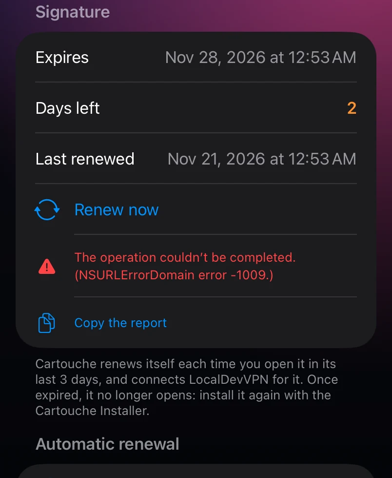
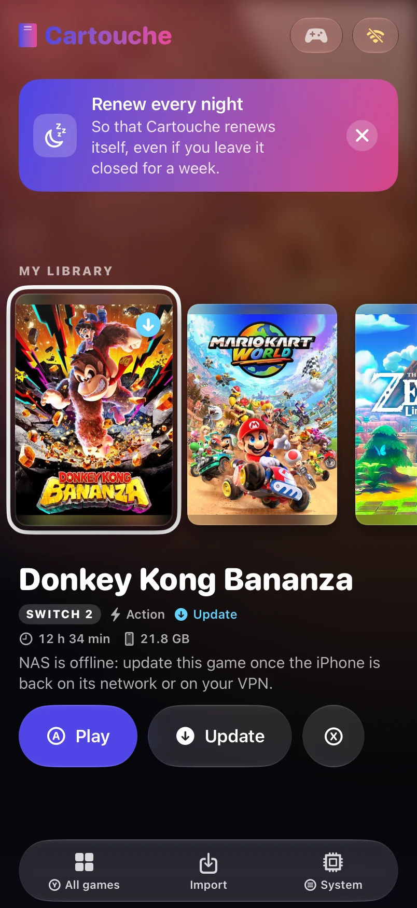

Under each error, Cartouche says why and what to do, and **Copy the report** gives whoever helps you what they need. Here are the most common cases.

## Signature and renewal

**Cartouche no longer opens.** Its signature expired: a free Apple account signs apps for seven days, and Cartouche was not opened in its last 3 days, nor renewed at night. Install it again with the [Cartouche Installer](/installer/), over this copy, with the same Apple account: your games and saves stay. Then make the [nightly automation](/iphone/system/#renewing-every-night).

**The home says "The certificate no longer works."** iOS no longer accepts it, perhaps after an install from another computer. Sign in again with your Apple account: Cartouche takes a new one.

**Apple says the session expired.** Cartouche can no longer renew or update itself until you sign in again: choose **Sign in again** on the System page, with the same Apple account. Your games and saves stay.

**Apple revoked the certificate.** Most likely another app or computer took a new one with the same Apple account. Cartouche can no longer renew itself with it: install Cartouche again over this copy with the Cartouche Installer, with the same Apple account.

**A part of the app is missing.** Cartouche says so as it signs in, renews or updates itself. Install it again over this copy with the Cartouche Installer, which puts it back.

**Cartouche says its IPA for SideStore was installed without its app group.** Some signing apps leave out the app group Cartouche's sign-in needs. Install Cartouche with the [Cartouche Installer](/installer/) from a computer instead, or, with your signing app, sign the IPA for your own certificate, `Cartouche-<version>-Own-Certificate.ipa`, from Cartouche's releases on GitHub.

**The pairing file is missing.** In the Cartouche Installer, **Put the pairing file in Cartouche again**.

**The renewal did not go through.** Check that LocalDevVPN is installed and can connect, then **Renew now** on the System page, which says why it failed.

**The nightly automation does not run.** **Renew every night**, on the System page, says what it saw. In Shortcuts, check that the automation is still there, on, set to **Run Immediately**, at a time when the iPhone is charging and online, and that **Enable LocalDevVPN** comes before **Refresh All Apps**, Cartouche's and not LiveContainer's.

## Games

**A game does not install: not enough room.** Cartouche says how much the game takes and how much is free. Free some space, then install it again.

**The IPA is damaged.** It ends early, or a file changed since it was made, as when a copy stops before the end. Copy it again from where it was built.

**The game was built without its game files.** Put its `romfs.img`, as nxnative wrote it, beside its IPA in your games folder, then install the game from there.

**The game closes as it starts, on an iPhone 15 or earlier.** nxnative needs a graphics chip that reads BC textures. Cartouche for Mac builds your games from nxnative-nobc for such an iPhone once they are paired: see [Build for each of your iPhones](/mac/builder/#build-for-each-of-your-iphones).

**iOS closed the game.** Near its memory limit behind the console, the game then starts in Cartouche's place, with all of Cartouche's memory. The game's sheet says whether it fits your iPhone. Otherwise, your progress is kept up to its last save.

**The game is not signed.** Sign it again by starting it once more; if it still fails, install it again from its IPA.

## Storage

**A place is offline.** It does not answer from where the iPhone is. At home, check its address and that the iPhone is on your Wi-Fi or your VPN. Away, turn on Tailscale. Your games play as ever, and your saves wait.

**Tailscale is off.** LocalDevVPN turned it off, as iOS keeps one VPN at a time: open Tailscale to turn it on again, or add its **Connect** action to the nightly automation.

**Google Drive asks to sign in again.** While your Google Cloud project is in testing, Google ends the sign-in after 7 days: **Sign in to Google again** on the Storage page.

**Cartouche does not find your Mac.** On the Mac, open Cartouche, with **Share with Cartouche on the iPhone** on. On the iPhone, allow Cartouche in **Settings › Privacy & Security › Local Network**. Be on the same Wi-Fi, or plug the iPhone into the Mac.

## Cartouche for Mac

**macOS cannot check the app.** The first time only: **System Settings › Privacy & Security**, then **Open Anyway** beside Cartouche.

**A build fails.** The error under the game in **Builds** says what to do: free room on a full disk, copy damaged game files again from your console, or update Xcode from **This Mac's tools**. A game whose build failed is tried again when nxnative or its files change; **Build again** tries now.

## Still stuck?

See [Getting help](/help/support/).
