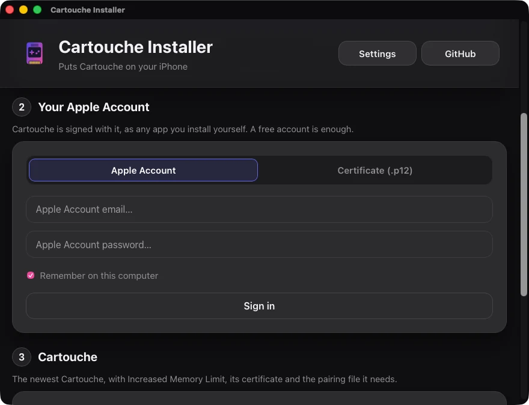

The Cartouche Installer puts Cartouche on an iPhone or an iPad from a Mac or a Windows PC, the one time a computer is needed. Its window has three steps.

| Computer | Download | First open |
| --- | --- | --- |
| Mac, Apple silicon or Intel, macOS 11 or later | [For Mac](https://cartouche.cloud/download/#installer-mac) | macOS cannot check it: in **System Settings › Privacy & Security**, click **Open Anyway** next to Cartouche Installer, once. |
| Windows 10 or 11 | [For Windows](https://cartouche.cloud/download/#installer-windows) | SmartScreen may stop the setup: **More info › Run anyway**. It installs for your account, with no administrator rights. Install **Apple Devices** from the Microsoft Store too. |

## The three steps

1. **Your iPhone:** plug it into the computer with a cable and unlock it. The first time, tap **Trust** on the iPhone and type its passcode.
2. **Your Apple Account:** sign in, a free account being enough, with the two-factor code Apple sends. **Remember on this computer** keeps the password in the computer's keychain.
3. **Cartouche:** **Install Cartouche** downloads the newest Cartouche from its releases, checks it, signs it with Increased Memory Limit and installs it, with its certificate and the pairing file it needs.

When it is done, the Installer says what to do on the iPhone the first time: trust your Apple account in **Settings › General › VPN & Device Management**, and turn on **Developer Mode** if iOS asks for it. Then open Cartouche: see [Install Cartouche](/start/install/#4-cartouches-setup).

## Install again, or update

Installing again over Cartouche keeps its games and their saves, and brings it to the newest version. Do it when:

- Cartouche's signature expired, after a week without opening it;
- Apple revoked the certificate Cartouche is signed with, as the System page then says;
- a part of the app is missing, as Cartouche says when it signs in, renews or updates itself.

Use the same Apple account as before.

## The pairing file

The pairing file lets Cartouche install and renew apps on the iPhone without a computer. The Installer puts it in Cartouche as it installs it. After the iPhone was erased, or its pairing deleted, **Put the pairing file in Cartouche again** puts it back, without installing Cartouche again.

## Settings

**Settings** holds the Installer's language (English, French, Spanish or German), your account's certificates and App IDs, the logs, and the pairing stored for the selected iPhone.

:::caution[Too many certificates]
A free Apple account has a limited number of development certificates. When it has them all, the Installer offers to revoke them and make a new one: apps signed with them stop opening until they are installed again.
:::

:::note[Three apps]
A free Apple account can have 3 apps of its own installed at a time, expired ones included. Your games run inside Cartouche and do not count.
:::

The Installer installs nothing but Cartouche, and never downloads anything but Cartouche's own releases.
