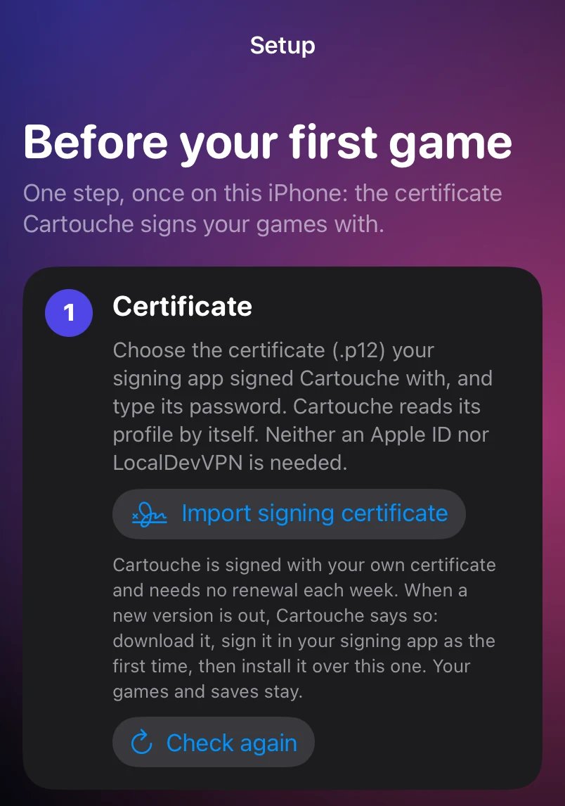

Signing with your Apple account stays the default. If you already have a signing certificate (.p12) and its provisioning profile, the Cartouche Installer can sign Cartouche with them instead: no Apple account, no LocalDevVPN and no weekly renewal.

Cartouche does not recommend certificate sellers, signing apps or signing services.

## Install with your certificate

1. In the Cartouche Installer, select your iPhone.
2. At the top of the Apple Account step, choose **Certificate (.p12)**.
3. Choose your certificate (.p12), type its password (leave it empty if it has none), and choose its profile (`.mobileprovision`).
4. Install Cartouche. Signing happens on the computer; the Installer signs in to no Apple account.
5. Open Cartouche: it takes your certificate by itself. If iOS asks you to trust the developer or to turn on Developer Mode, do it in Settings.

## What the profile must allow

- **Increased Memory Limit.** Without it, Cartouche and your games have far too little memory for most games. The Installer warns you when the profile lacks it: signing cannot add it.
- **The games' keychain groups.** A wildcard profile with your team's `*` keychain permission covers them.
- **Cartouche's App ID**, or a wildcard one that covers it.

## What changes

- Games start in Cartouche's place: keeping the console behind a game needs the app extensions a single profile cannot sign.
- Cartouche says when a new version is out. Install it from the Installer with your certificate, as the first time: your games, their saves and your certificate stay.
- A certificate that expires or is revoked is replaced the same way: install Cartouche again with the new one.

To go back to your Apple account, install Cartouche again with the Installer's **Apple Account** option.
