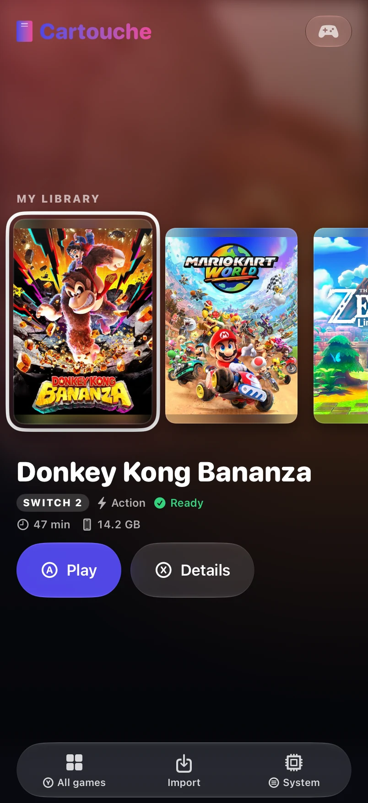
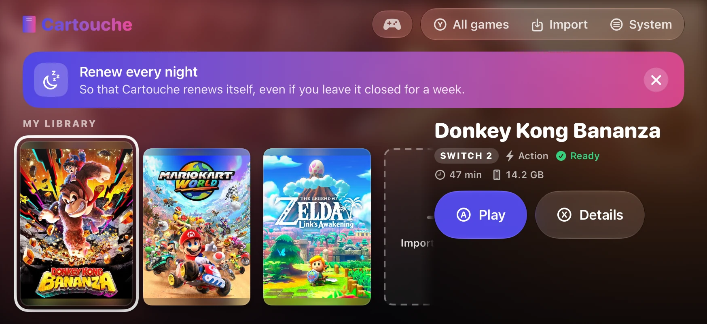
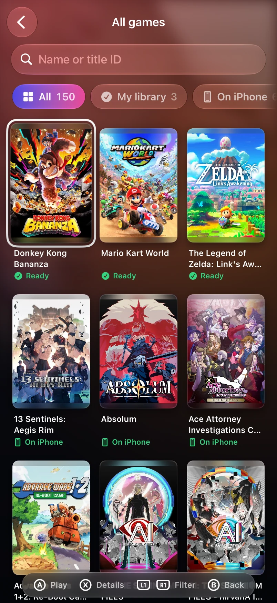

Cartouche opens on its console: your games, large, on one shelf, with their official covers. The game in focus shows everything you need to play it, and the rest of Cartouche is one step away.

## The home

- **My library:** your games, installed or in your games folder, then **Import** and **All games**.
- **The game in focus:** its name, platform, genre and status on this iPhone, the time you played it and the space it takes. **Play** starts it, **Details** opens its [sheet](/iphone/game-sheet/). When your games folder holds a newer build, **Update** installs it, saves kept.
- **The dock:** **All games**, **Import** and **System**. It sits at the bottom when the iPhone is upright, and in the top bar when it is sideways.
- **The top bar:** a controller when one is connected, and, in the last three days of Cartouche's signature, the days left.

A line under the game's status says what is left to do, such as a setup to finish, and goes away once the game is ready to play.

## All games

**All games** lists every game that has a profile in nxnative, yours first, each with its status under its cover. Search by name or title ID, and filter by **All**, **My library**, **On iPhone**, **On Mac**, **In bring-up** or platform.

A game you do not have shows only **Import my copy**: Cartouche never offers a download. A game in your games folder that is not installed yet shows **Install from** that place.

| Status | What it means |
| --- | --- |
| **Ready** | Your game, installed, with nothing in the way. |
| **In storage** | Its IPA is in your games folder: install it to play. |
| **Update** | A newer IPA of it is in your games folder: updating keeps your saves. |
| **Runs on this iPhone** | Other players' results on your model say it is playable. |
| **Not tried on this iPhone yet** | No result on your model yet. |
| **Not recommended on this iPhone** | It needs more memory than Cartouche has here, or players found it does not run. |
| **Not supported on this iPhone** | Its iOS version or graphics chip is missing. |

## Touch and controller

Touch and a game controller both drive every screen, and each button shows the controller's button for it.

| | Touch | Controller |
| --- | --- | --- |
| Move the focus | Tap a cover | D-pad or stick |
| Play, or the main action | **Play** | <kbd>A</kbd> |
| A game's sheet | Tap the game in focus, or **Details** | <kbd>X</kbd> |
| All games | **All games** | <kbd>Y</kbd> |
| Change the filter | Tap a filter | <kbd>L</kbd> <kbd>R</kbd> |
| System | **System** | <kbd>Menu</kbd> |
| Back, or close a page | **OK** | <kbd>B</kbd> |

A long press on one of your games offers **Play**, **Details**, **Uninstall**, and **Update from** your games folder when it holds a newer build.

## Import my copy

**Import** opens Files: choose the IPA of a game you built from your own copy, on your iPhone, iCloud Drive, a USB-C drive or a network share. Cartouche reads it where it is, installs it with a progress bar, then opens its sheet. An IPA nxnative built without its game files installs with the `romfs.img` beside it.

An IPA that is not an nxnative game goes to **System › Other installed apps**: the console shows games only.

:::note
Cartouche lists what it can run, never where to get a game. The only games it downloads are those [Cartouche Cloud](/cloud/) built for you, from the copy you sent it.
:::
