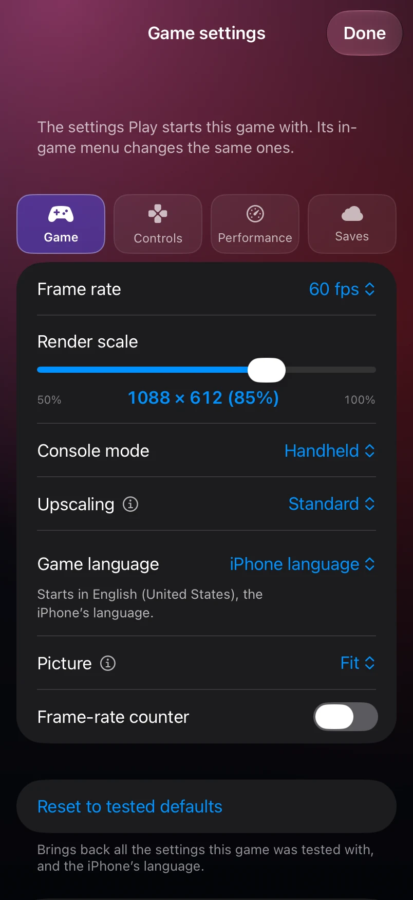
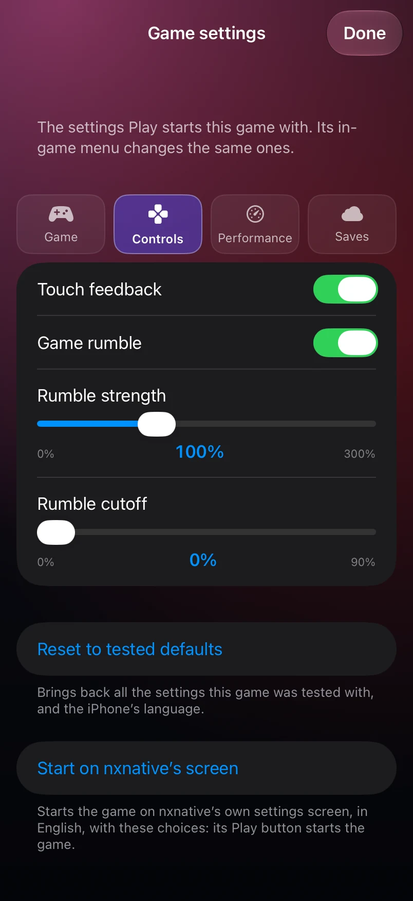

**Game settings**, on a game's sheet, holds the settings **Play** starts the game with: the ones nxnative's own screen shows before a game, on a page of Cartouche's, in your language. The game's in-game menu changes the same ones.

## Sections

The settings come in sections, **Game**, **Performance**, **Controls** and **Saves**, one at a time: tap a section, or press <kbd>L</kbd> and <kbd>R</kbd> on a controller. What a game offers depends on the game; the most common are:

- **Frame rate** and **Render scale**, with the size in pixels the scale gives.
- **Console mode:** **Handheld** or **Docked**.
- **Picture:** **Fit** or **Fill** the screen.
- **Upscaling**, **Dynamic resolution**, **Frame-rate counter** and **Performance HUD**.
- **Game rumble** and **Touch feedback**.
- **Game language** ([below](#game-language)).

The **ⓘ** beside a setting says what it does. A setting a game's files fix shows greyed out.

**Reset to tested defaults** brings back every setting the game was tested with, and the iPhone's language.

## Game language

A game speaks your iPhone's language when it has it. Before each start, Cartouche picks the first of your iPhone's languages, in the order of **Settings › General › Language & Region**, that the game offers. **iPhone language**, the setting's first choice, says which one that is.

A language you pick stays the game's until you choose **iPhone language** again, or **Reset to tested defaults**.

## Cloud saves

nxnative's own cloud saves, through a folder of iCloud Drive, are in the **Saves** section. Cartouche keeps your saves in step on its own, with the saves folder of your [storage](/iphone/saves/): you need only one of the two.

## nxnative's own screen

**Start on nxnative's screen** starts the game once on nxnative's settings screen, in English, with these choices: its **Play** button then starts the game.
