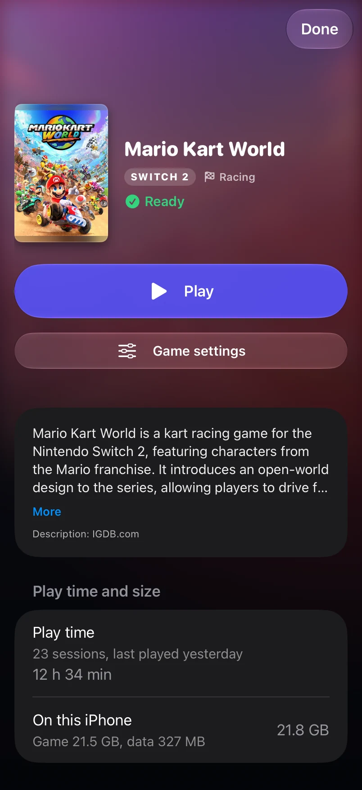
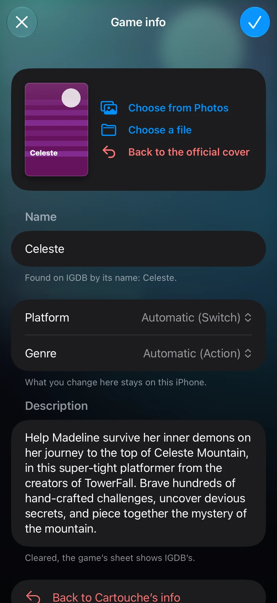
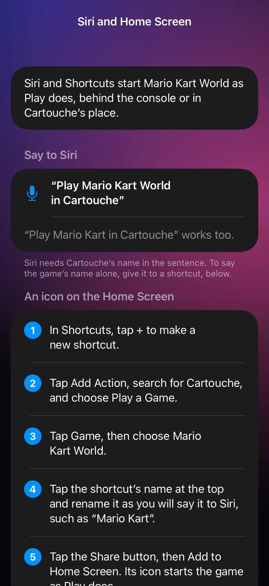
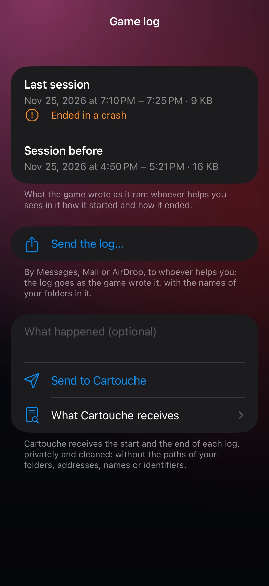

Every game has a sheet: **Details** on the home, or <kbd>X</kbd> on a controller. It says whether the game runs on your iPhone or iPad, and gathers everything you can do with it.

## At the top

- **Play** and **Game settings** for your own game; **Resume**, **Game settings** and **Quit** while it is [paused behind the console](/iphone/playing/).
- **Install from** your games folder, for a game there that is not installed yet, or **Import my copy** for a game you do not have.
- **Update from** your games folder when it holds a newer build, with the build installed and the newer one.

## What it tells you

- **The description**, yours or IGDB's. The iPhone translates it into Cartouche's language, with **Show the original** beside it.
- **Play time and size:** how long you played, how many times and when last; the space the game and its data take on this iPhone, and its IPA's size in your games folder.
- **What the game needs** against what this iPhone has: the memory, the iOS version and the graphics chip. When everything is there, it folds into one line, *This iPhone has what it needs*.
- **Testers' results**, those of your model first: how the game runs there, from what other players measured. Their notes are translated too.
- **Technical details:** the recommended settings, what nxnative says of the game, and the build installed.

On an iPhone whose graphics chip reads no BC textures (iPhone 15 and earlier), the sheet says the game stops before its first image, unless its build converts them, as games built from nxnative-nobc do: it then says *Textures converted for this GPU by this game's build*.

## What you can do

- **[Game settings](/iphone/game-settings/):** frame rate, render scale, handheld or docked, game language, and more.
- **[Saves](/iphone/saves/):** where they are kept, put back an older copy, or bring in a save from your console.
- **[Mods](#mods):** files that change the game's textures, texts, music or levels, turned on in the order you choose.
- **Edit the game's info:** give your game a name, platform, genre, description and cover of your own, from Photos or Files. They stay on this iPhone. **Back to Cartouche's info** undoes them. A game outside nxnative's list, built with a fork for instance, finds its cover and genre on IGDB by its name.
- **Siri and Home Screen:** what to say to Siri, *"Play Stardew Valley in Cartouche"*, and how to give the game its own icon on the Home Screen with the Shortcuts action **Play a Game**.
- **Share the log:** the game's log, for whoever helps you, by Messages, Mail or AirDrop, or **Send to Cartouche**, which removes your paths, addresses and names first. You see what goes before it goes.
- **Builds on** your Mac: with a Mac paired, where the game's build stands there, and a button to build it or stop it. See [Your iPhone and your Mac](/mac/iphone/).
- **Copy to** your games folder, and **Uninstall**, which asks whether its saves stay.

## Mods

A mod changes a game's textures, texts, music or levels: the game reads its files in place of its own. **Mods**, on the sheet, says how many are on. **Add a mod** takes one from Files, as its folder or its ZIP, as mods are passed around: Cartouche keeps its `romfs` folder, wherever it is inside. A pick that holds several mods gives each of them, turned off.

- Turn each mod on or off. Where two change the same file, the one higher up wins: **Move up** and **Move down** set the order. Up to 16 can be on at once.
- Changes take effect at the game's next start. Quit the game first if it is paused behind the console.
- A mod added with another version of the game says so: a mod made for one version may not work with another.
- A mod that changes the game's code too, with an `exefs` folder, cannot work on an iPhone or an iPad: iOS runs only the code signed with the game. Cartouche says so and leaves it out.
- Mods stay on this iPhone: they do not go to your saves folder. **Delete** removes a mod and its files.

Cartouche downloads no mod: you bring your own.

## Games outside nxnative's list

A game Cartouche has no sheet for still shows, as *No sheet yet*, and starts: Cartouche just cannot check what it needs. Its cover comes from IGDB by its title ID or its name.
