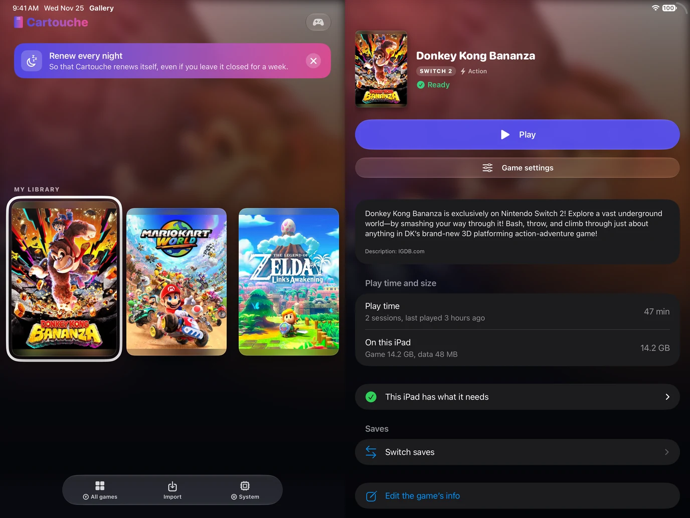
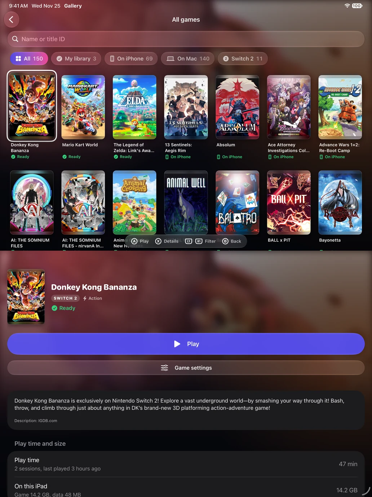

Cartouche is the same app on iPhone and iPad, installed the same way, and says "iPad" wherever it speaks of your device. It runs on an iPad with an M1 chip or newer, on iPadOS 26 or later.

- **In landscape**, the console and the game's sheet stand side by side.
- **Games are played sideways:** turn your iPad sideways to play. A game made to be played sideways stays sideways.
- **Everything else** works as on the iPhone: [storage](/iphone/storage/), [saves](/iphone/saves/), your [Mac](/mac/iphone/), [Cartouche Cloud](/cloud/) and the [System page](/iphone/system/).

Your saves follow you from your iPhone to your iPad and back, through your saves folder: the newest wins.
