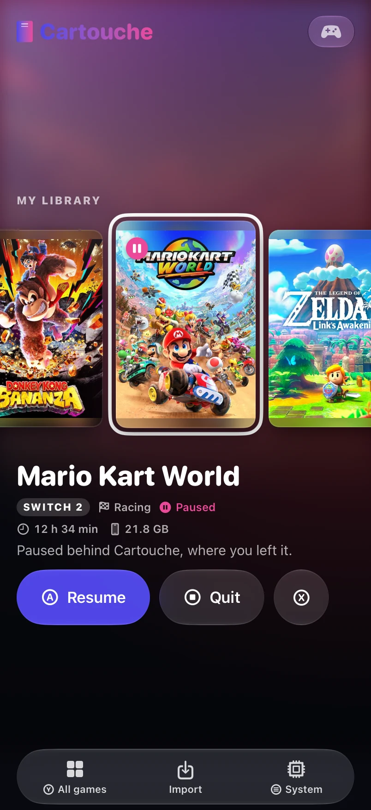
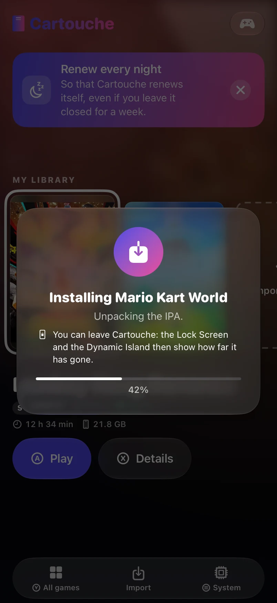

## The game waits behind the console

**Play** starts the game full screen, with Game Mode on: the most of the iPhone's processor and graphics chip, and your controllers with the lowest latency.

The **Home** button, at the bottom of the game's screen or on the controller, brings back the console without ending the game. The game stays paused where you left it:

- **Resume**, or the controller's Home button again, goes back to it;
- **Quit** ends it, once you have said so: progress since the game last saved is lost;
- **Play** on another game asks first, since one game runs at a time.

The on-screen Home button hides after a few seconds: touch just below where it was to bring it back.

## If the controller disconnects

When the last controller disconnects during a game, because its battery ran out or its Bluetooth link dropped, the game pauses 3 seconds later and the console comes back, saying that the controller disconnected. Connect it again and the game comes back by itself. **Resume** goes back to the game without one, on the touch controls.

- A game you play on the screen alone, without a controller, never pauses for one.
- A controller that comes back within the 3 seconds pauses nothing.
- **System › While a game runs › Pause when the controller disconnects** turns it off.
- A game that starts in Cartouche's place does not pause for its controller yet.

## A game that needs more memory

A game that needs more memory than it has behind the console starts in Cartouche's place instead, with all of Cartouche's memory: the console closes while it runs, and opens again when the game ends. The game's sheet says so, with **Try behind Cartouche again**.

If iOS closes a game near its memory limit behind the console, Cartouche says so, and the game starts in Cartouche's place from then on. **System › While a game runs › Keep Cartouche open behind the game** turns the console behind the game off for every game.

## On a TV

Connect the iPhone to a TV with a cable, or mirror its screen with AirPlay to an Apple TV or a TV that has AirPlay. The TV shows the game alone, as a console on its dock, and the controls stay on the iPhone. With the TV, the game stays sideways.

There is no Apple TV version: the iPhone runs the game and sends it to the TV.

## Upright or sideways

Hold the iPhone upright, and a game built by a recent nxnative turns with it, its picture above its controls. A game built before stays sideways. On an iPad, turn it sideways to play.

## Siri and the Home Screen

Say *"Play Stardew Valley in Cartouche"* to Siri, or use **Play a Game**, Cartouche's action in Shortcuts: the game starts as **Play** starts it. A shortcut of it added to the Home Screen gives the game an icon of its own. Each game's sheet shows how, under **Siri and Home Screen**.

## Installing and updating a game

A game in your games folder installs from its sheet or from the home, with **Install from** that place. The screen says how it comes, by cable, through Tailscale or over Wi-Fi, and how fast, with a tip when it could go faster.

- You can leave Cartouche meanwhile: the Lock Screen and the Dynamic Island show how far it has gone, in a Live Activity.
- A dropped connection picks up where it stopped once the network is back.
- A newer build of a game in your games folder shows as **Update**: updating keeps your saves.
- A game built without its game files installs with the `romfs.img` beside its IPA in the games folder.

When something stops an install or a start, Cartouche says why and what to do, and **Copy the report** under the error gives whoever helps you what they need. See [Troubleshooting](/help/troubleshooting/).
