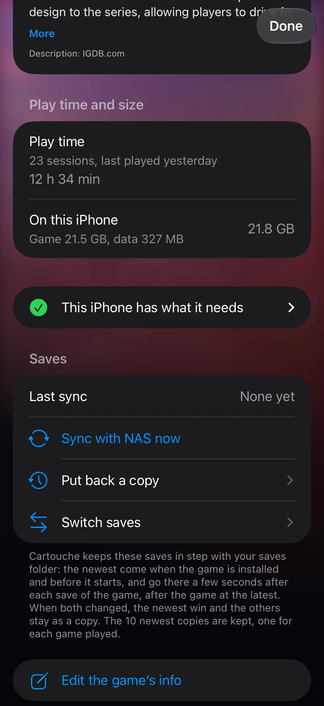
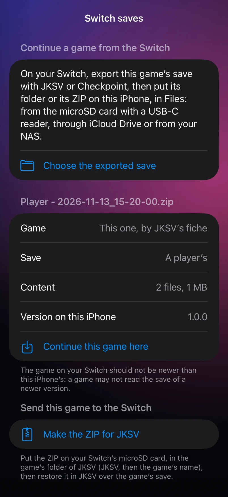

With a saves folder chosen in **System › Storage**, Cartouche keeps each game's saves in step with it, a folder per game. Your saves follow you from one iPhone or iPad to the next, and to your Mac, through your Mac or your NAS.

## How they stay in step

- **They go** a few seconds after each save of the game, while you play, and after the game at the latest.
- **They come** when you install the game and before you play, as after you install Cartouche again, or after another iPhone or your Mac played it.
- **The newest wins.** When both sides changed, the saves written last win, and the others stay in the folder as a copy of their own.
- **Ten copies** of each game are kept, the newest first.
- **Each copy names the version of the game** that wrote it: an older version of the game never takes it, and the sheet says the copy comes once the game is updated.

A saves folder that does not answer, a NAS while you are away, keeps your saves waiting: Cartouche copies them as soon as it answers again.

## On a game's sheet

The sheet's **Saves** says when they were last in step and what the last sync did.

- **Sync with** your folder **now**, when the game is not running.
- **Put back a copy:** choose one of the game's copies, the newest first. Cartouche sends the current saves to your folder first, so that you can come back to them.

## A game from your console

Your game goes on here, from where you left it on your console:

1. On your console, export the game's save with JKSV or Checkpoint.
2. Put its folder or its ZIP on this iPhone, in Files.
3. On the game's sheet, open **Saves**, then **Switch saves**, and **Choose the exported save**.
4. **Continue this game here.** Cartouche checks that the save is this game's, keeps the one it replaces, and, with a saves folder, sends it there as the newest.

**Put back the game from before the import** undoes it.

The other way, **Make the ZIP for JKSV** makes the game's save into a ZIP: put it on your console's microSD card, in JKSV's folder of the game, and restore it in JKSV.

:::caution
The game on your console should not be newer than the one on your iPhone: a game may not read the save of a newer version.
:::

## On the Mac

Cartouche for Mac keeps the saves of the games played on the Mac in step with the same folder, with the same rules. See [The console on the Mac](/mac/console/#your-saves-on-the-mac).
