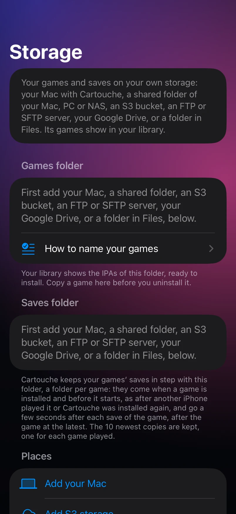
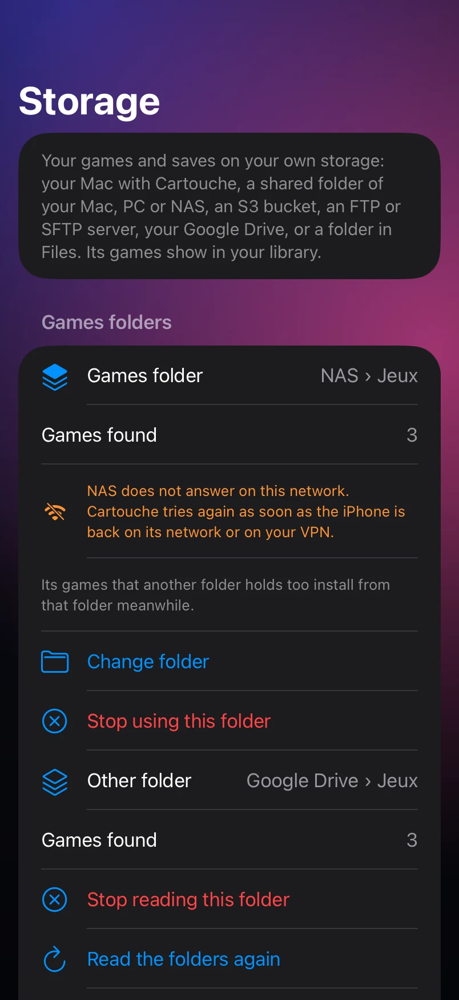
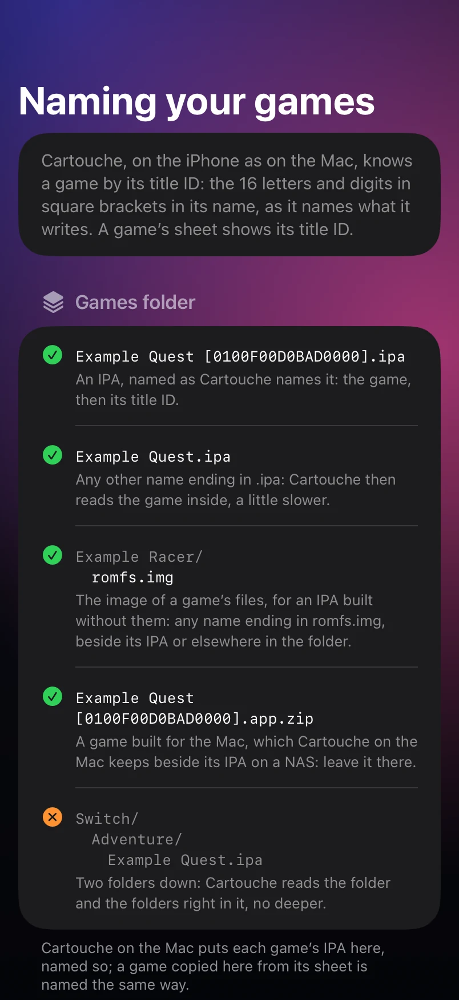
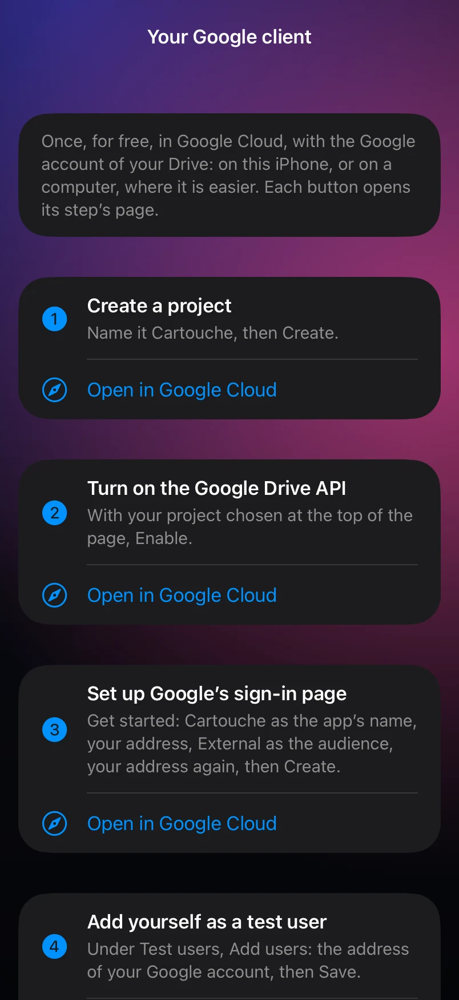

Your games and saves stay at home, on storage of your own, with your own account. **System › Storage** sets it up: the games there show in your library, ready to install, and Cartouche keeps your saves in step there, from one iPhone or iPad to the next.

There is no address to paste for a download, no link to follow and no public bucket: only your own places, with your own account. Passwords stay in the iPhone's keychain.

## Places

| Place | How Cartouche reaches it |
| --- | --- |
| **Your Mac** | Through [Cartouche for Mac](/mac/iphone/), on your Wi-Fi or by cable: paired once with six digits shown on both screens, then everything goes encrypted. |
| **Shared folder (SMB)** | SMB 2 or 3, on your Mac, PC or NAS, with your account there, or as a guest. The servers on your network show by themselves. |
| **S3 bucket** | A private bucket of yours, on Amazon S3 or a server of your own such as MinIO, with an access key of your account. Each request is signed with your keys. |
| **FTP or SFTP server** | Your NAS's or your Mac's, with your account. Over SFTP, Cartouche keeps the server's key and refuses any other. FTP sends the password unencrypted: keep it for your own network. |
| **Google Drive** | Your My Drive, through a Google client of your own, made once and free ([below](#google-drive)). Cartouche carries no Google key. |
| **Folder in Files** | Any folder the Files app reaches. |

The first time, iOS asks to let Cartouche find devices on your local network: allow it, or Cartouche cannot see your Mac or NAS.

## Games folder

Choose the folder that holds your games' IPAs. Your library then shows each of them, ready to install, and a newer build of an installed game shows as an update, saves kept.

- **Add another games folder**, on any of your places: a game found in several folders shows once, and installs from a folder that answers, at home or away.
- **Copy to** on a game's sheet copies the installed game to your games folder, the first one: do it before you uninstall a game you have no IPA of.
- A folder your account can only read is fine: Cartouche installs its games and writes nothing there.
- A game nxnative built without its game files comes as an IPA and a `romfs.img`: keep the two side by side, and Cartouche installs them together.

## Saves folder

Choose the folder where Cartouche keeps a copy of your saves, a folder per game. See [Your saves](/iphone/saves/).

## How to name your games

Cartouche knows a game by its title ID, the 16 letters and digits in square brackets in its name, such as `Celeste [01002B30028F6000].ipa`, and finds most IPAs even without it. **How to name your games**, under the games folder, shows with examples which names Cartouche finds, which it leaves aside, and why.

## Away from home

With **Tailscale**, which you install apart from the App Store on the iPhone and on your Mac or NAS, signed in to the same account, Cartouche reaches them wherever you are: your Mac by itself, a NAS by its name or its address in Tailscale. **Away from home**, on the Storage page, says whether Tailscale is connected.

iOS keeps one VPN at a time, so LocalDevVPN turns Tailscale off when Cartouche renews itself. With Tailscale on, Cartouche waits for the last 2 days of its signature to renew, then tells you to turn Tailscale on again. See [Renewing every night](/iphone/system/#renewing-every-night).

## When a place does not answer

A server that does not answer from where the iPhone is, a NAS at home while you are away, is *offline*. Your installed games play as ever, your games folder keeps its last list, and your saves wait: Cartouche copies them as soon as the server answers again. It tries again each time the iPhone changes network, every minute while Cartouche is open, and when you ask.

## Google Drive

Cartouche has no Google key of its own: it reaches your Drive through an OAuth client of yours, of the iOS type, made once for free in Google Cloud.

1. On the Storage page, choose **Add Google Drive**.
2. **Make your client, step by step** opens each page of Google Cloud in turn, with Cartouche's bundle ID to copy: create a project, turn on the Google Drive API, set up Google's sign-in page, add yourself as a test user, create the client.
3. Paste the client ID, tap **Sign in with Google**, and allow access to your Drive. Google says it has not verified the app: it is yours, choose **Continue**.
4. Choose your games folder in My Drive.

While your Google Cloud project is in testing, Google ends the sign-in after 7 days: **Sign in to Google again** brings the Drive back, and your saves wait meanwhile.

## The same storage on your Mac

Once your iPhone is paired with [Cartouche for Mac](/mac/iphone/), the two keep the same connections, passwords included: one you add, change or remove on either comes to the other. On the Mac, the console's **System › Storage** shows them.

## Your iPhone's backups

The games Cartouche installs stay out of your iPhone's backups, in iCloud or on a computer, so that they do not fill your iCloud: each takes gigabytes, and installs again from your storage. Their saves still go in the backup.
