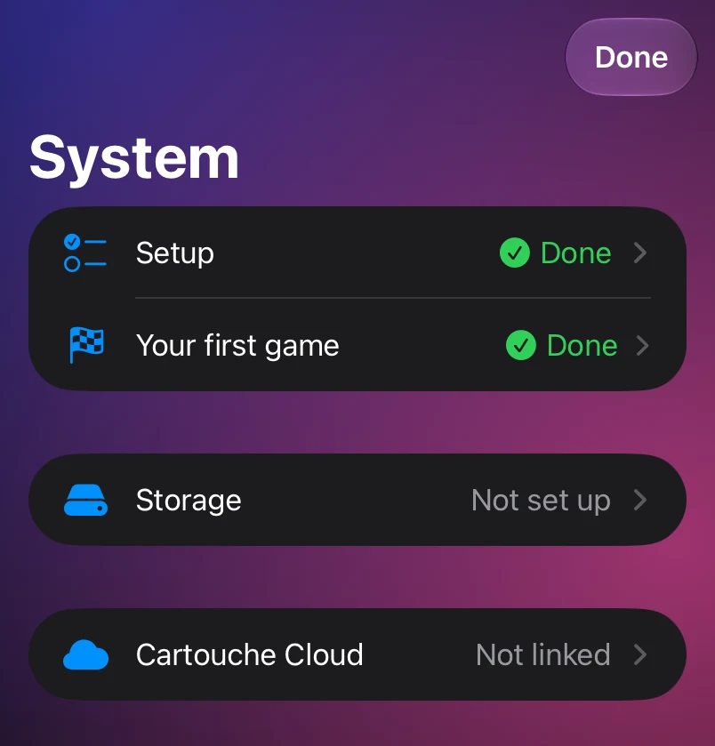
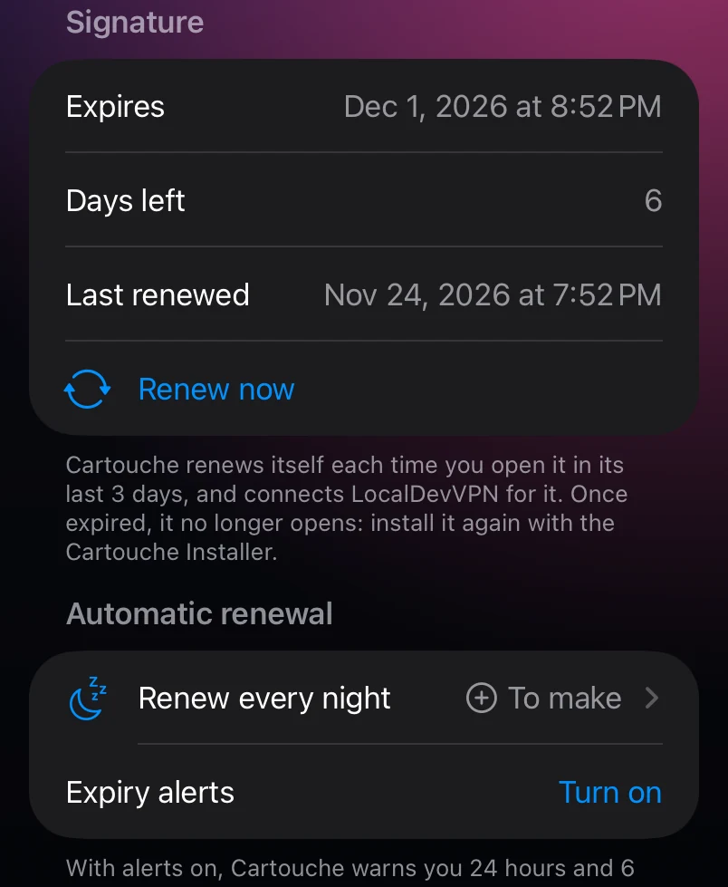
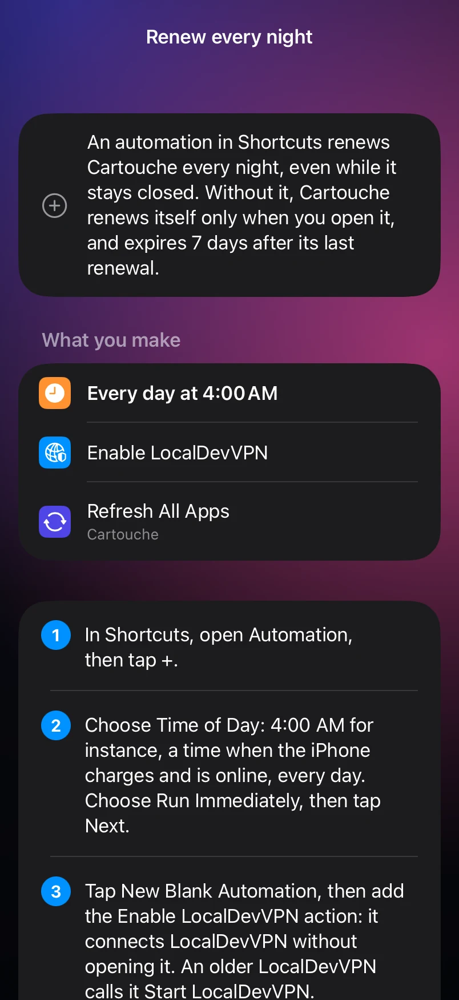
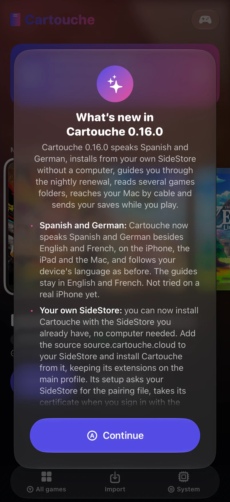
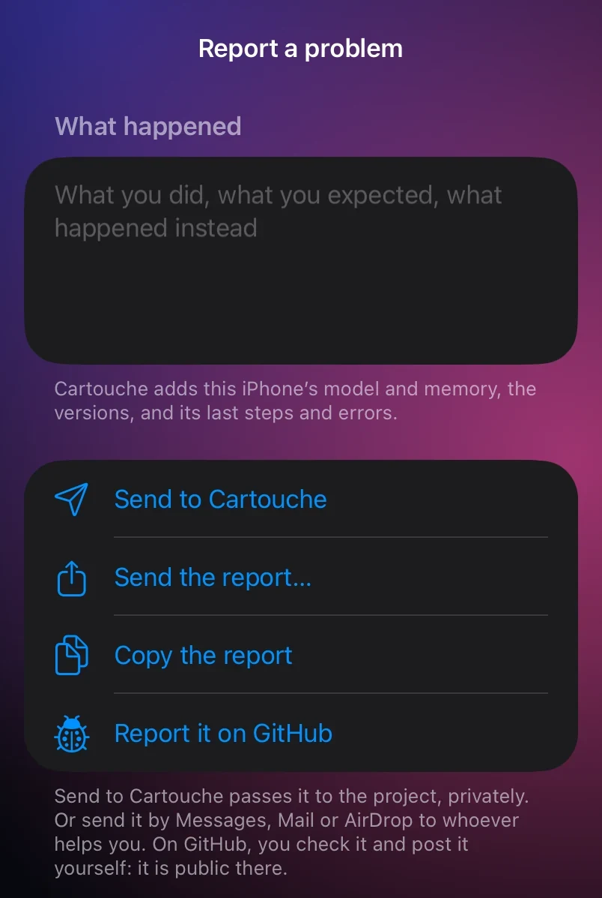

**System**, on the console's dock or the controller's <kbd>Menu</kbd> button, opens over the console. **OK**, or <kbd>Menu</kbd> again, closes it.

## Setup and signature

**Setup** shows Cartouche's setup steps, ticked once done. **Signature** says when Cartouche's signature expires and the days left.

A free Apple account signs apps for seven days. The built-in SideStore renews Cartouche by itself, through LocalDevVPN, which Cartouche connects:

- each time you open Cartouche in the last 3 days of its signature;
- when you tap **Renew now**, without leaving Cartouche;
- every night, with the Shortcuts automation [below](#renewing-every-night).

With **Expiry alerts** on, Cartouche warns you 24 hours and 6 hours before it expires. Once expired, Cartouche no longer opens: install it again with the [Cartouche Installer](/installer/), over this copy, which keeps your games and saves.

Apple session expired? Cartouche signs in again by itself, or asks you to, with **Sign in again**.

## Renewing every night

An automation in Shortcuts renews Cartouche every night, even while it stays closed. iOS lets no app make it for you, so you make it once:

1. In Shortcuts, open **Automation**, then tap **+**.
2. Choose **Time of Day**: 4:00 AM for instance, a time when the iPhone charges and is online, every day. Choose **Run Immediately**, then tap **Next**.
3. Tap **New Blank Automation**, then add the **Enable LocalDevVPN** action: it connects LocalDevVPN without opening it.
4. Then add **Refresh All Apps**, among Cartouche's actions and not LiveContainer's, and tap **Done**.
5. Back in Cartouche, tap **I made the automation**.

Cartouche follows every run: **Renew every night**, on the System page, says whether it is to make, made, on, or failed and why, and what to fix.

:::tip[With Tailscale]
LocalDevVPN turns Tailscale off, as iOS keeps one VPN at a time. Add Tailscale's **Connect** action last in the automation, and it turns on again by itself.
:::

## Updates

Cartouche offers its new versions over the console, and installs them itself through LocalDevVPN, without a computer. It then closes: open it again. Your games, their saves and Cartouche's settings stay.

After an update, Cartouche opens on **What's new**, in your language. **System › Updates** also has **Check for an update**, and **What's new** of the last versions.

## Memory

Cartouche gets **Increased Memory Limit**, even with a free Apple account. **Memory** shows the limit iOS gives Cartouche here, the one it gave the last game behind the console, and whether Increased Memory Limit is active. **While a game runs** holds **Keep Cartouche open behind the game** ([Playing](/iphone/playing/#a-game-that-needs-more-memory)).

## Storage, builds and Cartouche Cloud

- **[Storage](/iphone/storage/):** your games folder, your saves folder and your places.
- **Builds on** your Mac: with a Mac paired, all its builds, driven from the iPhone ([Your iPhone and your Mac](/mac/iphone/)).
- **[Cartouche Cloud](/cloud/iphone/):** link this iPhone to your account, and follow the games built for you.

## Game measurements

After each game, Cartouche sends what nxnative measured while it ran, such as frame rate and memory, so that games run better on iPhone, iPad and Mac. Never your Apple account, your iPhone's name, your files, the addresses of your storage or the game's log. **System › Game measurements** shows what is sent, turns it off, and erases what this iPhone sent. See [Privacy](/about/privacy/).

## Report a problem

**Report a problem** shows a full report of what went wrong, with this iPhone's model, the versions and Cartouche's last steps and errors, without passwords, server names or addresses, user names or Apple account. Nothing leaves the iPhone until you choose how: **Send to Cartouche**, privately, or by Messages, Mail or AirDrop to whoever helps you. See [Getting help](/help/support/).

## Other installed apps

An IPA you installed that is not an nxnative game shows here, not on the console. It opens in Cartouche's place, and can be uninstalled from here.

## Reset Cartouche

**Reset Cartouche** erases everything you put in Cartouche, your games and their saves here, your settings and your storage, then starts it again as it opened the first time, without a computer. Saves that are not in your saves folder are named first, with **Send them to the saves folder now**. What your storage holds, the certificate and the pairing file stay.

## Language

Cartouche speaks English, French, Spanish or German: it follows your iPhone's language.
