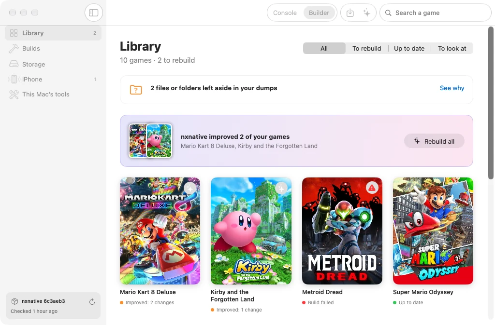
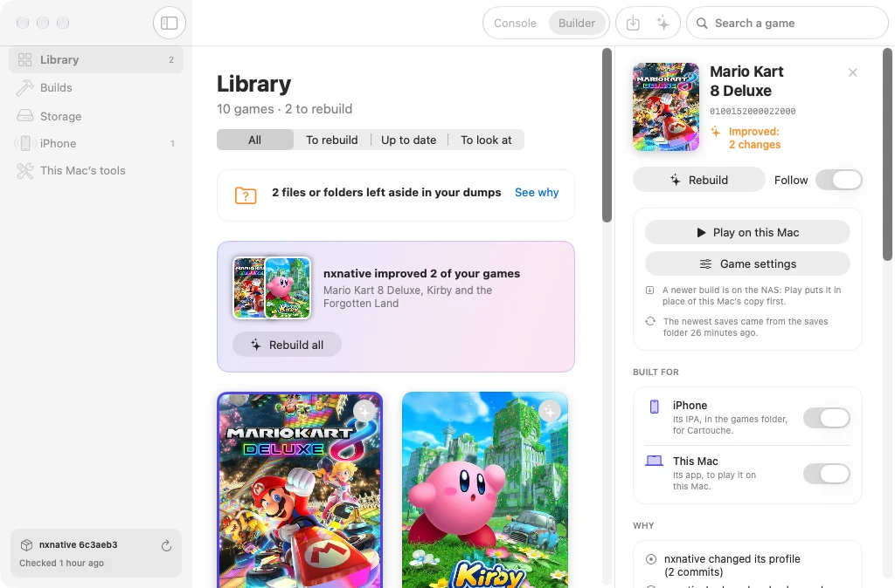
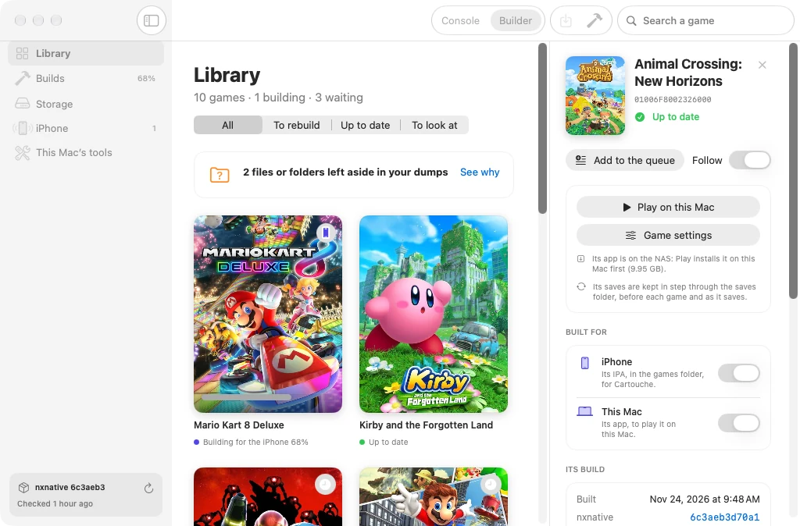

**Builder**, at the top of the window or <kbd>⌘</kbd><kbd>2</kbd>, shows the Builder. It builds each of your games with nxnative into an IPA for the iPhone and iPad, and an app for this Mac, puts them in your games folder, and builds them again when nxnative improves them.

## The library

**Library** shows your games with their covers: those of your dumps folder, and those whose IPA alone is in your games folder. Each says whether it is up to date, due for a rebuild and why, built at night, or failed and what failed. Filter them by **All**, **To rebuild**, **Up to date** or **To look at**.

A game's sheet shows what nxnative changed for it since its build, its IPA and its app for this Mac, **Build**, **Rebuild** or **Build again**, whether it is followed, and what it is built for.

## Building

Open a game and choose **Build**. A large game's first build takes hours; the next ones reuse its build folder and take minutes. **Builds** shows the batch under way, game by game and step by step, its queue, and the batches before with their reports.

- A game asked for while a batch builds, with **Add to the queue**, waits its turn at the end of the batch.
- **Stop this game** stops only the game building; **Stop all** stops the batch and empties its queue.
- A notification says when a batch ends.

## Updates and DLC

Put a game's update and DLC in your dumps folder with the game: the Builder builds them into it, the newest update and every DLC.

- **Packages** (`.nsp`, `.xci`, `.nsz`, `.xcz`) can be beside the game, in a folder of their own, such as `Zelda/Update/`, or anywhere else in the dumps folder: the Builder knows their game by its title ID. They need `prod.keys`, chosen in the setup assistant or in the settings.
- **A dump** holds them in `updates/<version>/` and `dlc/`; a Switch 2 game's `.nup` holds those packed in it.
- **A `.nup` without its DLC** takes them as images: put each DLC's image, `1.img`, `2.img`… by its number, in a folder named `aoc` beside the `.nup`, in the game's own folder. nxnative makes such an image of each DLC it builds a game with, in the `aoc` folder of the game's build folder. A `.nup` that holds DLC of its own keeps those.
- **A new update or DLC** in the dumps folder builds the game again. Cartouche on the iPhone then offers the update on the game's sheet, saves kept.

## When nxnative improves your games

nxnative gets dozens of changes a day. The Builder reads what changed since each game's build, and builds a game again only when it gains something:

| A game is built again when | |
| --- | --- |
| it was never built, or its IPA left the games folder | |
| its folder holds new files | a new update, DLC or dump |
| a change of nxnative is made for it | its profile, or a fix that names it |
| nxnative's shared code changed | every week by default; or at once, or never, in the settings |
| Xcode changed | |

**nxnative improved** a few of your games? **Rebuild all** builds them. Cartouche on the iPhone then offers each update on the game's sheet, saves kept.

A game whose build failed waits for nxnative or its files to change instead of failing again every night; **Build again** builds it at once.

## Every night

**Build what is due every night**, in the settings, builds what nxnative improved at the time you choose, even with the app closed. The Mac stays awake while it builds, and a notification says how it went. A share of your NAS that is not mounted is mounted again by itself.

## Built for the iPhone and the Mac

Each game is built for the iPhone and iPad, and for this Mac too, unless you turn one of the two off under **Built for**, for every game in **Settings › Builds**, or for one game on its sheet. See [Playing on the Mac](/mac/console/#playing-on-the-mac).

## Build for each of your iPhones

The iPhone 15, the iPhone 15 Plus and earlier models have a graphics chip that reads no BC-compressed textures, which nxnative needs. **Settings › Builds › Build for** says whom the games are for: your paired iPhones, by default, or a model you choose. When one of them reads no BC textures, the Builder builds every game from [nxnative-nobc](https://github.com/mianmuhammadse/nxnative-nobc), a separate fork of nxnative by mianmuhammadse that converts those textures; otherwise from nxnative. The setting says which and why.

## Little room on the Mac

Each game keeps a build folder that makes its next build fast. The Builder keeps your disk from filling: it removes the files it extracts once a build ends, removes the build folders used the longest ago when the disk runs low, and says before a build how much room is missing. **Storage** shows what the Builder keeps, with **Free**.

## When a build does not go through

The error under a game in **Builds** says what to do when you can act on it: a full disk, damaged game files to copy again from your console, or an Xcode to update. When nxnative's newest change breaks a game's build, the Builder builds it from an earlier change that worked, by itself.

## What it never does

It never downloads, shares or uploads a game, a key or an IPA anywhere but your own storage: it builds the games you own from your own files, on your Mac, into your own games folder.
