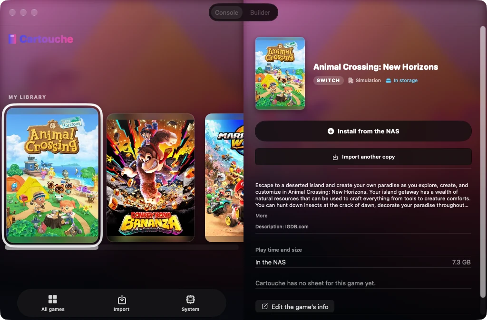
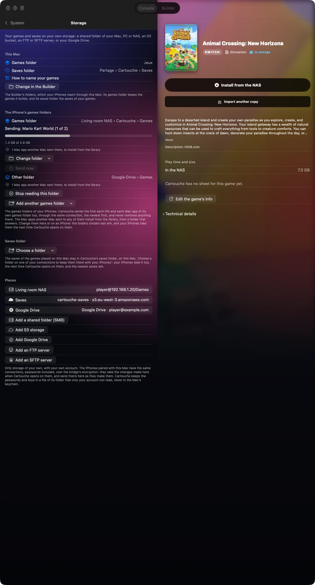

**Console**, at the top of the window or <kbd>⌘</kbd><kbd>1</kbd>, shows Cartouche's console, as on the iPhone: your games built for this Mac, with their covers, the game in focus with **Play**, and its sheet beside it.

## Playing on the Mac

**Play** starts the game at once, full screen, Cartouche's window behind it, with your newest saves. <kbd>⌃</kbd><kbd>⌘</kbd><kbd>F</kbd> puts it in a window. When the game ends, Cartouche comes back in front.

- **Game settings** opens the game's settings on its sheet, as on the iPhone, with the Mac's own: display mode, Fullscreen or a window, and controllers.
- The game speaks your Mac's language when it has it, until you choose one.
- A game your NAS keeps that is not on this Mac yet shows too: **Install from the NAS** installs it, then **Play** starts it. The menu beside **My library** shows them all, only those **Installed** on this Mac, or only those **Not installed**, as on the iPhone.
- **Remove from this Mac** puts its app in the Trash; the game stays in your games folder.
- When the last controller disconnects during a game, the game pauses 3 seconds later and Cartouche comes back in front, saying so. A controller connected again brings the game back; so do **Resume**, and the game brought to the front from the Dock. **System › While a game runs** turns it off.

The sheet also says how long you played the game on this Mac and whether it runs here.

## Your saves on the Mac

The Mac keeps the saves of the games played there in step with your saves folder, as the iPhone does: the newest copy comes before a game starts, and the Mac's saves go a few seconds after the game saves. When both sides changed, the saves written last win and the others are kept as a copy. Every profile of the game goes with them, with the room the game made for each, and the shaders it prepared come back, as on the iPhone. The sheet shows them, with **Sync with … now** and **Put back a copy**, and brings in a save from your console as on the iPhone. **Put back a copy** also lists, under **On this Mac**, the copies each game makes of its saves as it starts, to go back to the start of a game ([Your saves](/iphone/saves/)).

This Mac's copy of a game your NAS keeps stays out of Time Machine: it comes again from the NAS. The game's saves still go in.

Without a saves folder of your choice, Cartouche Builder keeps the saves in its own folder, on this Mac alone: once your first game is over, the console's home offers to choose one, on iCloud Drive or your NAS, and its × takes the offer away for good.

## Mods

A game's sheet has **Mods** on the Mac too, as on the iPhone ([A game's sheet](/iphone/game-sheet/#mods)): add a mod from a folder or a ZIP on this Mac, turn it on or off and set the order. A mod that changes the game's code too, with an `exefs` folder, does not work on the Mac yet: Cartouche says so and leaves it out. The Mac's mods stay on this Mac.

## System

**System**, on the console's dock, opens the iPhone's System page with this Mac's own sections:

- **Your first game:** the guide, in this Mac's three steps: the setup assistant, a game built for this Mac, and that game played.
- **Storage:** your connections, the same as your paired iPhones', and the Mac's games and saves folders ([below](#the-same-storage-as-your-iphone)).
- **Open the Builder**, with its settings.
- **While a game runs:** **Pause when the controller disconnects** ([above](#playing-on-the-mac)).
- **This Mac:** its model, chip and macOS, and whether its graphics chip has what nxnative needs.
- **Updates:** Cartouche for Mac's, with **Check for an update** and **Install updates by itself**.
- **Game measurements** and **Report a problem**, as on the iPhone.

## The same storage as your iPhone

Your paired iPhones and the Mac keep the same connections to your storage, passwords included: a shared folder, an S3 bucket, an FTP or SFTP server or your Google Drive added on one comes to the other. The games folder and saves folder you choose on either are kept by both.

When the games folder chosen on the iPhone is on one of your connections, the Builder sends it each game it builds, one at a time, so that your iPhone finds them even while the Mac sleeps.
