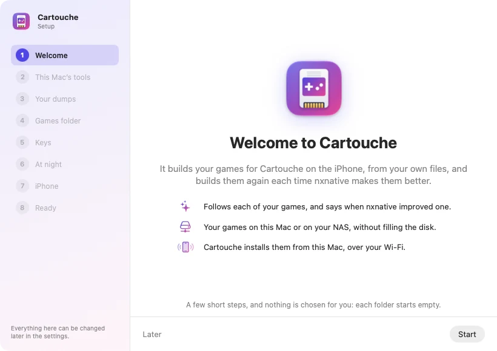
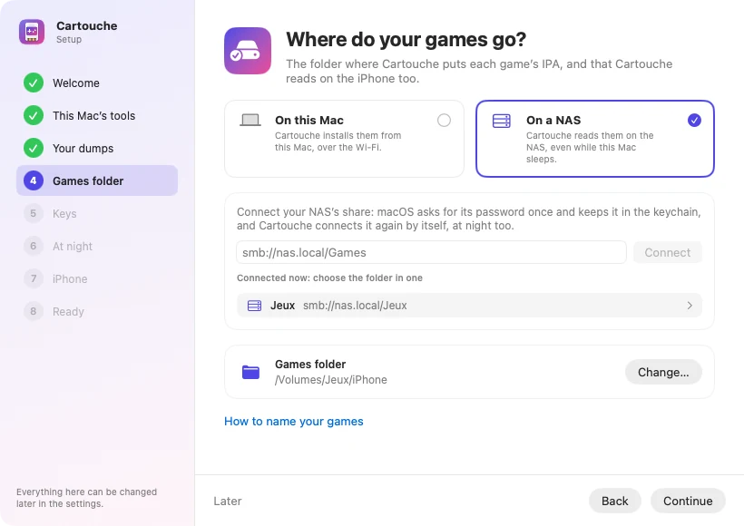
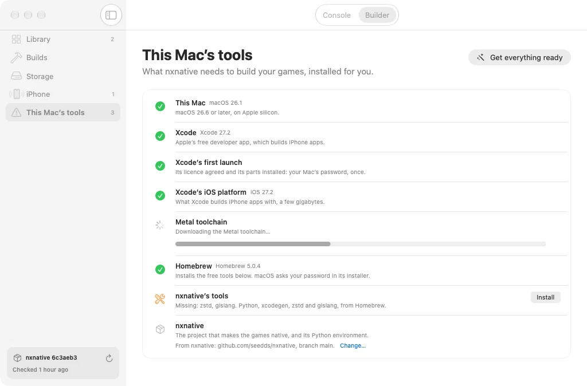

On the Mac, Cartouche is one app: its **console**, as on the iPhone, and the **Builder**, which builds your games with nxnative from your own copies, for the iPhone, the iPad and the Mac. It needs a Mac with Apple silicon and macOS 26.6 or later.

## Download and first open

1. [Download Cartouche for Mac](https://cartouche.cloud/download/#builder): the disk image downloads at once.
2. Open it, and drag **Cartouche** onto **Applications**.
3. Open Cartouche from Applications. The first time, macOS says it cannot check it, as it is not signed by Apple: in **System Settings › Privacy & Security**, click **Open Anyway** beside Cartouche, once. Its updates open without asking again.

## The setup assistant

At its first start, a setup assistant sets up the Mac with you, a step at a time. Nothing is chosen for you: every folder starts empty. Each choice is saved as you make it, and all of them can be changed later in the settings, where **Advanced › Open the setup assistant** opens it again.

1. **Welcome:** what the app does.
2. **This Mac's tools:** **Get everything ready** installs what nxnative builds with. Xcode comes from the App Store, which the app opens for you; Homebrew asks for your Mac's password; the rest installs in the background while you go on to the next steps.
3. **Your dumps:** the folder of your games, as you dumped them from your console, on the Mac or on your NAS. The Builder only reads it.
4. **Games folder:** where your games' IPAs go, on this Mac or on your NAS. It is the folder Cartouche reads on the iPhone too.
5. **Keys:** your console's keys, `prod.keys`, for games given as packages.
6. **At night:** whether to build what is due every night, and when.
7. **iPhone:** whether the Mac shares its games and saves with Cartouche on the iPhone, and how to pair it.
8. **Ready:** what each step chose, with a button back to it.

:::tip[Your games on a NAS]
For a folder on your NAS, type its share's address in the assistant and the Finder connects it, then choose the folder in it. macOS keeps the password in the keychain, and Cartouche connects the share again by itself, at night too.
:::

## This Mac's tools

**This Mac's tools**, in the Builder, shows each tool nxnative needs, installed or missing, with an install for what is missing, and **Update Xcode** when nxnative needs a newer one.

## Your dumps

The Builder reads your games as your console's packages (`.nsp`, `.xci`, `.nsz`, `.xcz`, with their updates and DLC, which need `prod.keys`, or `.nup`), as dumps, or as a `.zip` of a dump. They can be loose in the folder, one folder per game, or in folders of folders. A game is known by its title ID; the library says what it left aside, and why.

**Naming your games**, under **Folders** in the settings, shows with examples what the Builder and Cartouche make of each name.

## Updates

Cartouche for Mac looks for its new versions when it opens and every six hours. A new version is downloaded, checked, and put in place when the app quits, or at once with **Restart**. **Install updates by itself**, in the settings, can be turned off: the app then offers each update instead.

## Next

[Build your games](/mac/builder/).
