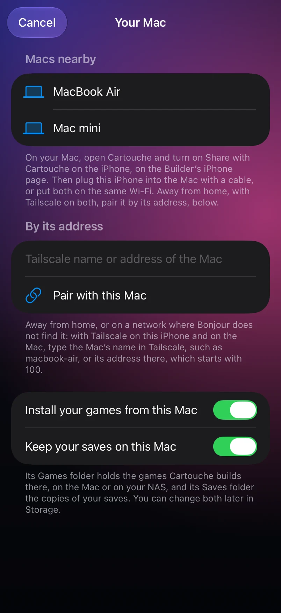
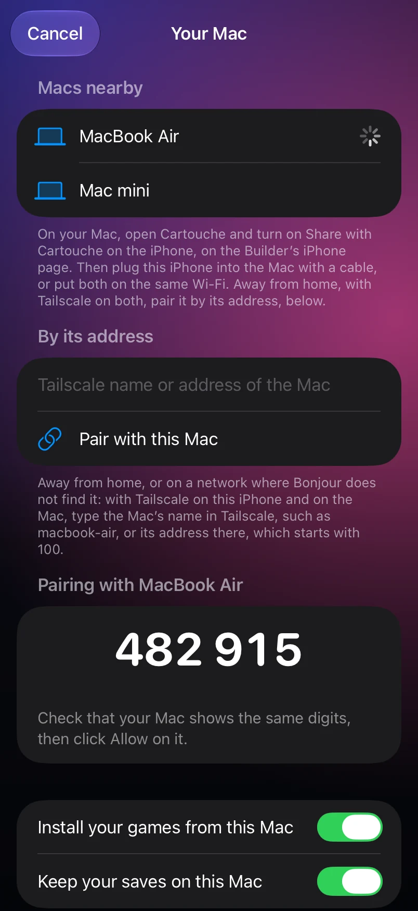
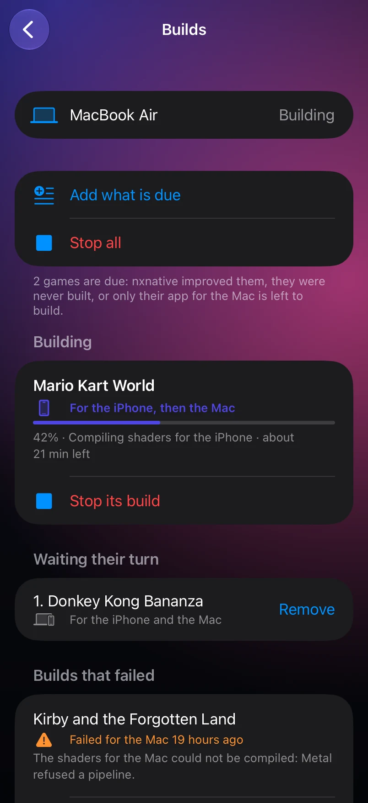
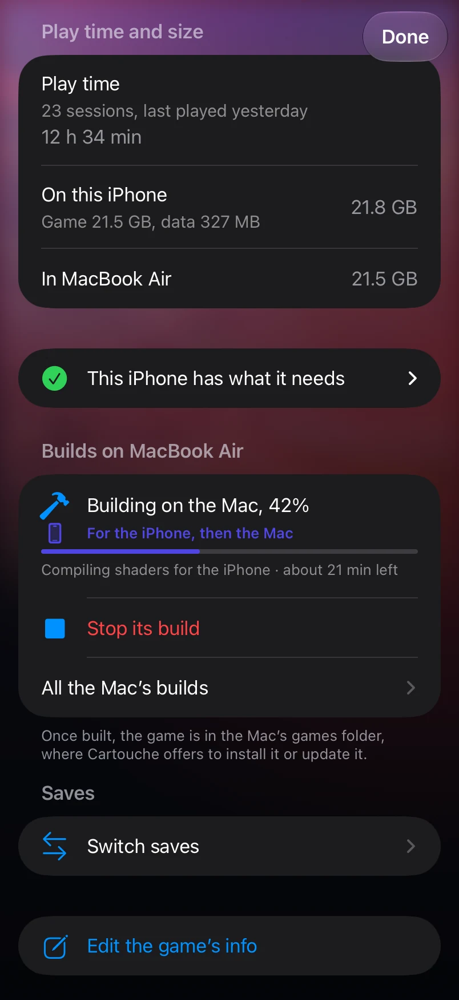

Paired once, your Mac becomes a storage place of Cartouche on the iPhone: Cartouche installs your games from it and keeps your saves there, encrypted on the way. And the iPhone drives the Mac's builds.

## Pair them

1. On the Mac, in the Builder's **iPhone** page, turn on **Share with Cartouche on the iPhone**.
2. On the iPhone, in **System › Storage**, choose **Add your Mac**, then your Mac under **Macs nearby**. The first time, allow Cartouche to find devices on your local network.
3. Both screens show six digits: when they are the same, click **Allow** on the Mac.

The Mac shares two folders, and nothing else of it can be reached: **Games**, your games folder, wherever it is, on the Mac or on your NAS; and **Saves**, the folder you choose for the copies of your saves. The key the two share never crosses the network, and every message is encrypted.

## On Wi-Fi, by cable, or away from home

- **By cable:** plug the iPhone into the Mac, and it reaches the Mac through the cable, with no Wi-Fi. **Add your Mac** lists that Mac first, **By cable**. The iPhone must trust the Mac, as the Finder asks once.
- **On your Wi-Fi:** the iPhone finds the Mac by itself, or at the address it last reached it at, through your VPN too. The Mac stays awake while an iPhone is connected.
- **Away from home:** with Tailscale on the Mac and on the iPhone, signed in to the same account, the iPhone reaches the Mac through Tailscale. A Mac never met on your Wi-Fi pairs by its Tailscale name or address, under **Add your Mac › By its address**.

The Mac answers while Cartouche is open on it.

## Drive the Mac's builds from the iPhone

- Each game's sheet shows **Builds on** your Mac: building, with how far and the time left, waiting its turn, up to date, improved by nxnative, or failed and why. Its button asks the Mac to build it, now or after the batch running, or stops its build.
- **System › Builds on** your Mac shows all its builds, as its own window has them: **Build what is due**, **Stop all**, the queue with **Remove**, the builds that failed, **Follow** for each game, and **Build what is due every night** with its time.

The Mac's folders, its tools and its settings stay on the Mac.

## The same connections

Once paired, the iPhone and the Mac keep the same connections to your storage, passwords included: one you add, change or remove on either comes to the other. See [The same storage as your iPhone](/mac/console/#the-same-storage-as-your-iphone).

## Keep both up to date

Cartouche on the iPhone and Cartouche for Mac speak to each other: when one is much older, the iPhone says to update both. Cartouche for Mac updates itself; an old Cartouche for Mac that no longer finds its updates gets the link from the iPhone, in **System › Builds on** your Mac.
