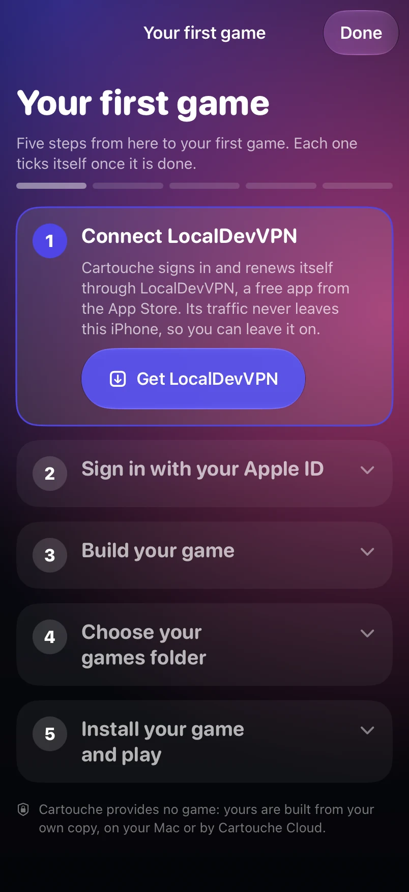
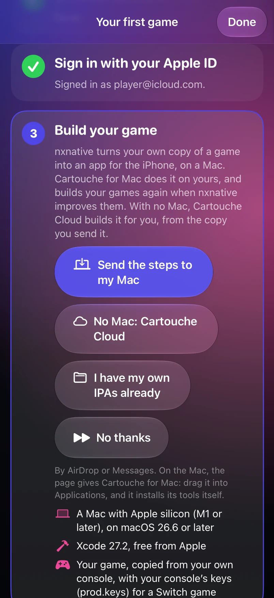
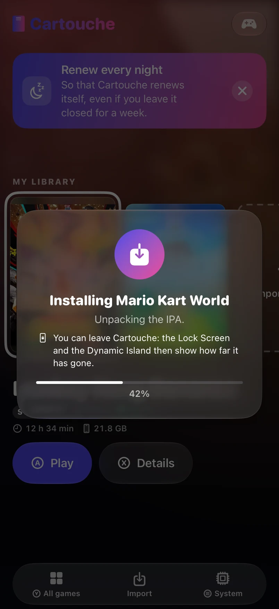

The first time you open Cartouche, its guide, **Your first game**, opens on the step to do. Each step ticks itself once it is done, in any order, and the guide takes you all the way to playing.

## 1. Connect LocalDevVPN and sign in

The setup's steps, from [Install Cartouche](/start/install/#4-cartouches-setup). The guide shows them first when they are not done yet.

## 2. Build your game

Your game is your own copy, dumped from your console. nxnative turns it into an app for the iPhone, on a Mac. Choose the way that fits you:

- **With your Mac:** **Send the steps to my Mac** sends the Mac, by AirDrop or Messages, the page with [Cartouche for Mac](/mac/install/). Install it there; it builds your game and puts it in your games folder.
- **No Mac: Cartouche Cloud** opens [Cartouche Cloud](/cloud/): send your copy from a computer, and the game built for you comes to Cartouche.
- **I have my own IPAs already** opens Files: the IPA you choose installs.
- **No thanks:** your games are built already, on your NAS for instance. The guide goes on to your games folder.

## 3. Choose your games folder

**Choose the games folder** opens the [Storage](/iphone/storage/) page: add your Mac, a shared folder of your NAS, an S3 bucket, an FTP or SFTP server, your Google Drive or a folder in Files, then choose the folder that holds your games. Cartouche lists your games from there and offers their updates.

With Cartouche Cloud, you need no games folder: the guide skips this step. No games folder at all? **Import an IPA instead** installs an IPA from Files.

## 4. Install your game and play

Your game shows in the guide's last step and in your library. **Install** installs it, from your games folder or from Cartouche Cloud, then its sheet opens with **Play**.

Your next games go the same way: built on the Mac or by Cartouche Cloud, then installed.

## Open the guide again

- The **×** on the guide's card takes it off the home.
- **System › Your first game** opens it again whenever you want.
- Until you have a game, **How to get a game**, beside **Import my copy**, opens it too.

On the Mac, Cartouche's console has its own guide, in three steps: the setup assistant, a game built for this Mac, and that game played. See [The console on the Mac](/mac/console/).
