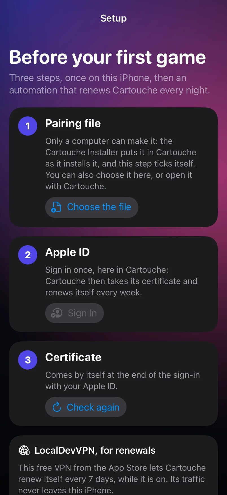

A computer is needed once, to put Cartouche on your iPhone or iPad. After that, Cartouche signs, renews and updates itself without it. Already use SideStore? [Install it from there instead](/start/sidestore/), with no computer.

On an iPad, every step is the same, with the iPad in place of the iPhone.

## 1. LocalDevVPN on the iPhone

Install **LocalDevVPN**, free, from the App Store. Cartouche signs in and renews itself through it. Its traffic never leaves the iPhone, and Cartouche connects it by itself when it needs it.

## 2. The Cartouche Installer on your computer

1. Download the Cartouche Installer [for Mac](https://cartouche.cloud/download/#installer-mac) or [for Windows](https://cartouche.cloud/download/#installer-windows). On Windows, install **Apple Devices** from the Microsoft Store too, so that Windows can talk to the iPhone.
2. Open it. It is not notarized by Apple or Microsoft, so the first time:
   - on a Mac, open **System Settings › Privacy & Security** and click **Open Anyway** beside Cartouche Installer, once;
   - on Windows, if SmartScreen stops the setup, choose **More info › Run anyway**.
3. Plug the iPhone into the computer with a cable and unlock it. The first time, tap **Trust** on the iPhone and type its passcode.
4. In the Installer, sign in with your Apple account (a free one is enough), and type the code Apple sends to your devices.
5. Click **Install Cartouche**. The Installer downloads the newest Cartouche, checks it, signs it with Increased Memory Limit and installs it, with its certificate and the pairing file it needs.

More on the Installer, its settings and what to do when it stops: [Cartouche Installer](/installer/).

:::tip[Your own signing certificate]
Have a signing certificate (.p12) and its provisioning profile? The Installer can sign Cartouche with them instead, with no Apple account and no weekly renewal. See [Your own certificate](/installer/own-certificate/).
:::

## 3. The first time on the iPhone

Before Cartouche opens the first time:

1. In **Settings › General › VPN & Device Management**, trust your Apple account.
2. If iOS asks for it, turn on **Developer Mode** in **Settings › Privacy & Security**, and restart the iPhone.

## 4. Cartouche's setup

Open Cartouche. Its setup takes a few steps, once:

1. **LocalDevVPN, for renewals:** **Connect LocalDevVPN** connects it and brings you back to Cartouche.
2. **Apple ID:** sign in with the Apple account you gave the Installer, and type the code Apple sends. Cartouche takes its certificate.
3. **Pairing file:** already put there by the Installer; this step ticks itself.
4. **Renew every night:** the last step shows the Shortcuts automation to make once, so that Cartouche renews itself every night even while it stays closed. See [Renewing every night](/iphone/system/#renewing-every-night).

Once the setup is done, Cartouche renews its seven-day signature by itself and offers its own updates. Your games and their saves stay through every update.

## Next

[Your first game](/start/first-game/): Cartouche's guide takes you from here to playing.
