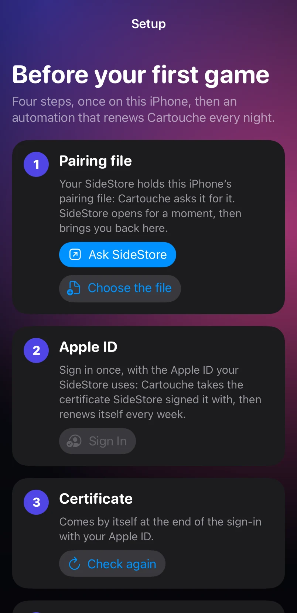

If SideStore is already on your iPhone or iPad, you can install Cartouche from it, with no computer.

1. In SideStore, add Cartouche's source: `https://source.cartouche.cloud`. On the iPhone, the button below adds it for you.

   <a href="sidestore://source?url=https://source.cartouche.cloud">Add to SideStore</a>

2. Install **Cartouche** from that source. When SideStore asks, choose **Keep App Extensions (Use Main Profile)**: Cartouche needs them to run your games behind its console.
3. Open Cartouche. Its setup asks your SideStore for the pairing file and takes its certificate: there is no Apple account to type again.
4. Cartouche then installs itself again, once, to get Increased Memory Limit, the memory your games need.

From then on, Cartouche renews and updates itself as after an install with the Installer. Its setup ends with the same last step, [Renew every night](/iphone/system/#renewing-every-night).

:::note
A copy of Cartouche signed by another app on the iPhone starts no game, except the one from Cartouche's source for SideStore. If you have your own signing certificate, see [Your own certificate](/installer/own-certificate/).
:::

## Next

[Your first game](/start/first-game/).
